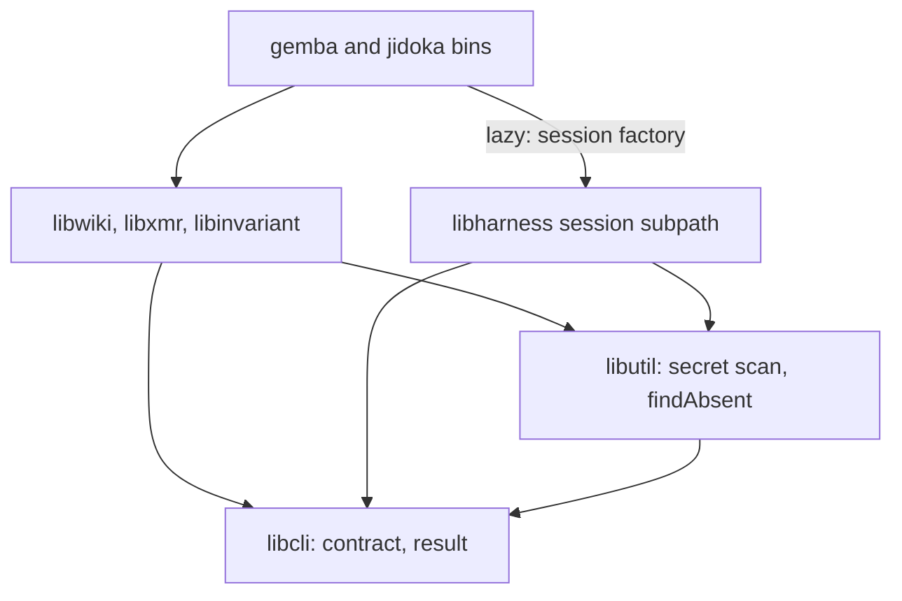
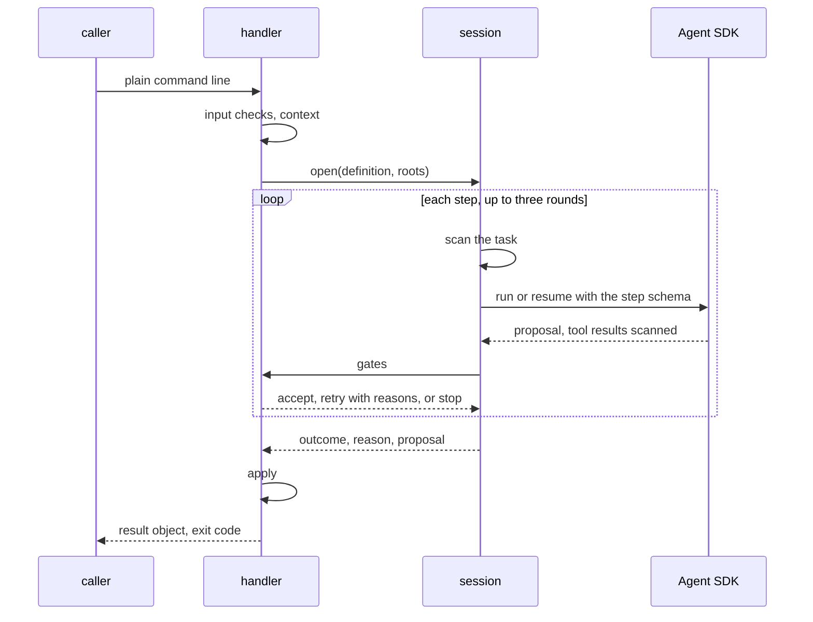

# Design 2410-a: one command-agent session in the runtime, one result contract in the CLI layer, and the judgment as data in each domain library

Spec 2410 turns nine commands into agent-backed commands with one path, gates
that decide, and one result contract. This design fixes the components, the
dependency direction, the session and gate interfaces, the push flow, the
outcome table, and the removals. It lands after specs 2370, 2390, and 2400
and rebases onto them.

## Components

| Component | Home | Role |
| --- | --- | --- |
| Command contract | `libcli` | The outcomes, their exit codes, and `resolveOutcome`, which applies the spec's precedence. The gate verdict (`accept`, `retry` with reasons, `stop` with a reason id). The reason-table shape (id, outcome, `next`). The definition shape and the time limits. An `agentBacked` mark on a command definition, from which `libcli` adds `--verbose` (and `--format` where the CLI has no global one) and renders the six-field result object, with `next` on stderr. |
| Command-agent session | `libharness`, on its own subpath | Opened per call from a definition and the roots the handler computes. `step(task, schema, gates)` runs, then resumes, one SDK session for up to three rounds, and returns the outcome, reason, proposal, and the step's tool results. It scans the task and the given input files before the first round, wraps every tool it gives the agent with the scan, enforces the limits, writes the run's trace, and calls `deleteSession` when it closes. |
| Agent runner | `libharness` | Gains the output schema, the `tools` allowlist, the `hooks` option, and explicit `settingSources: []` and `skills: []`. It reports the SDK error kind, and the session's reason table maps it. |
| Secret scan | `libutil` | `scanText`, `scanFiles`, and the commit-range scan that moves from `libwiki`, all over gitleaks. A caller may pass an allow rule. Only `libwiki` passes one: `FIT_WIKI_SECRET_OVERRIDE` for wiki text, with its audit line written into the wiki write-set. |
| Content presence | `libutil` | `findAbsent`, moved from `libwiki`'s integrity module, with a unit-splitter parameter: lines for the merge and conservation gates, sentences for `jidoka fix`. |
| Command definitions | `libwiki`, `libxmr`, `libinvariant`, `libharness` (`ask`) | Data per command. The role prompt is a markdown asset, embedded as `fit-terrain` embeds its prompts. |
| Handlers, readers, gates, appliers | The same libraries | Each handler reads its context, opens the session through the factory in its deps, gates each step, and applies. `jidoka fix` gets its handler in `libinvariant`, and its bin stays thin. The relative-link resolver moves from the repository invariant into `libinvariant`, and the invariant imports it. The metrics row writer and the metrics-reference table reader live in `libxmr`, which `libwiki` already uses. |
| Factory wiring | The `gemba` and `jidoka` bins | A bin imports the session subpath lazily, only for a command marked `agentBacked`. Each bin keeps its legacy tail for its other commands. |
| Publish flow | `libwiki` | One flow for `push`, `claim`, and `release`, in the order of § The push flow. It reports every end as one reason id from its table. |
| Trace tools | `libharness` | Read-only in-process tools over the trace query class and the multi-trace aggregates. Every list is paged with a bound and a cursor. |
| Test doubles | `libmock` | `createMockAgentQuery` gains editor file effects. A scripted session factory serves the handler tests. |
| Actions | `gemba-wiki`, `gemba-bootstrap`, `kata-agent`, `kata-interview` | The `gemba-wiki` action gains an `anthropic-api-key` input, passed to every command it runs. Each action that carries the new binaries or passes the key releases under a new major. |

## Dependency direction

No domain library imports `libharness` or the Agent SDK. `libwiki` drops its
dependency on `libharness`. `libxmr` and `libinvariant` gain none.

## Three agent kinds

| Kind | Commands | Tools | Writes | Limit |
| --- | --- | --- | --- | --- |
| Proposer | `push`, `log`, `inbox`, `memo`, `claim`, `record` | None. The task carries the context. | None. The applier writes the accepted proposal. | 30 s per step |
| Reader | `ask` | The trace tools only | None | 30 s per step |
| Editor | `jidoka fix`, `gemba-wiki fix` | Read, Glob, Edit, and Write | Inside the write roots only. A PreToolUse hook denies any path outside them and scans each file before a read. | 180 s per run |

Schemas use enums for decisions and lists of records for items. Each item
names the input id it answers, and code maps the id to a location for
`pending`. The completeness gate refuses a proposal that leaves an input id
undecided. An editor's manifest names the findings each edited file serves.
Findings that share a file form one group. The handler gates each group, and a
refused group returns its files to the snapshot that the session takes after
`fix`'s rotation pre-pass, deleting any file the group created.

## Data flow

### The push flow

1. A lock in the wiki's git directory admits one push per clone. A push waits
   for it within its limit, and ends in `failed` (`push-busy`) when the wait
   runs out.
2. The guards run: a merge or rebase in progress, a detached head, and
   ancestry.
3. The handler scans the outgoing diff. It commits the write-set when one
   exists, and folds all local commits not on the remote into one.
4. Step one asks for the commit body. With nothing outgoing, the step still
   runs, and the call ends in `noop` with no amend. Otherwise the commit is
   amended with the body under the fixed subject.
5. The flow fetches and rebuilds the commit on the fresh tip in a temporary
   index, never the working tree. A file that one side changed takes that
   side. A file that both changed takes git's three-way merge under the wiki's
   attributes, so the union driver still merges the metrics CSVs. Each file
   that still conflicts goes to step two, the resolver, after a scan of its
   three versions. The claim and release row is resolved by their row
   operation here, and their tip check runs on every fetch.
6. The marker, secret, budget, conservation, and ancestry gates run on the
   rebuilt tree. One ref update then moves the branch, and the flow pushes. A
   rejected push rebuilds once more, as today. A second rejection ends in
   `failed`.

A kill at any point leaves the working tree and the branch as step 3 or step 6
left them. The conservation guard reads only the fixed subject.

## Outcomes

| Outcome | Exit | Reason ids |
| --- | --- | --- |
| `done` | 0 | `landed`, `written`, `answered`, `fixed` |
| `noop` | 0 | `nothing-to-push`, `already-satisfied`, `no-wiki`, `claim-held`, `inbox-empty`, `clean` |
| `failed` | 3 | `credentials`, `scanner-unavailable`, `model-error`, `time-limit`, `schema-retries`, `turn-limit`, `transport`, `rejected`, `remote-unreachable`, `push-busy` |
| `needs-human` | 4 | `unresolved`, `gate-retries`, `both-sides-line`, `findings-left`, `residue-conflict`, `budget`, `rebase-in-progress`, `mid-merge`, `detached-head`, `would-publish-markers`, `conservation` |
| `blocked` | 5 | `secret-detected`, `introduced-scan-failed`, `unrelated-history`, `claim-taken` |

The session's table owns the loop reasons, the scan's table owns the secret
reasons, the publish table owns the publish reasons, and each command owns
the rest. The publish table replaces `refusalEnvelope`, `PUSH_REASONS`,
`WikiSyncRefusal`, `WikiPushFailure`, `AncestryRefusal`, and
`WikiSyncConflict`. `release` maps it to its legacy exit codes. A test lists
every table and checks each `next`. Exit codes 3 to 5 belong to agent-backed
commands only.

The justfile `wiki-push` recipe becomes the one Stop-hook home, and
`.claude/settings.json` calls it with a 120-second timeout. It reads
`stop_hook_active`, exits 2 on push exits 4 and 5 unless that flag is set, and
exits 0 otherwise.

## Key decisions

| Decision | Choice | Rejected | Why |
| --- | --- | --- | --- |
| Who writes | Proposers and the reader write nothing. Editors write inside their roots, against a snapshot, gated by finding group. | Every agent edits files. All-or-nothing editor runs. | The writers already pass the audit. One finding the agent cannot fix must not void the fixes it made. |
| Dependency direction | Definitions are data, the contract is in `libcli`, and the bin injects the session lazily. | Libraries import `libharness`. A static import in the bins. | An import puts the SDK under `libxmr` and the `jidoka` checks. The `libharness` index loads the SDK on import. |
| Contract home | `libcli`. | `libutil`. | Every library that needs the contract already depends on `libcli`, which owns exit codes today. |
| Gate verdict | `accept`, `retry`, or `stop`. | Accept or refuse. | A safety refusal must end the call at once, and a retry invites a proposal reshaped around the gate. |
| Tool control | The `tools` allowlist and a PreToolUse path hook. Other runner callers keep `disallowedTools`. | A permission callback. | The runner pins bypass mode, and the SDK never calls the callback there. |
| Merge seam | Rebuild on the tip in a temporary index. One rebuild seam for all three commands. | Resolve inside a stopped rebase. Keep the singleton loop beside it. | A kill mid-rebase blocks every later push. Two retry loops would drift. |
| Commit order | Guards, scan, commit, then the body. | Ask for the message first. | An outage then leaves a local commit that the next push carries. |
| Secret scan | The session scans the task, the given input files, and every tool result. Editors scan at read time. | Scan whole read roots. | Old findings in sealed logs that no command can edit would block every run. |
| Override | Wiki text only, through `libwiki`'s allow rule. | An override for every command. | The override and its audit log belong to the wiki. Other text has no audit home. |
| Run files | Resume across rounds, then `deleteSession` at close. | `persistSession: false`. Move `CLAUDE_CONFIG_DIR`. | The rounds need resume. Moving the config directory hides the local login. |
| Prompt home | Markdown assets on the existing embed path. | JS modules. Agent profiles. | `fit-terrain` already embeds prompt assets. A Jidoka-only repository has no profiles. |
| Structured output | The SDK output schema. | A conclude tool. Parse the text. | A conclude tool is optional to call. The judge is out of scope. |
| Exit codes | 0, 0, 3, 4, 5. Exit 1 stays for an unexpected error. | 1 for `failed`. | A crash must not look like a retryable failure. |
| Model | The fast model constant. | A larger model for `ask`. | One constant to measure first. |

## Removals

| Removed | Replaced by |
| --- | --- |
| `fix`'s private loop, round cap, task builders, profile prompt, its exits that skip the agent, and `libwiki`'s `libharness` dependency | The session and the `fix` definition |
| The flag parsers and options that spec § C lists | The free-text argument and the appliers |
| `product-mix`'s subprocess call to `gemba-xmr record` | The `libxmr` row writer |
| The nineteen query handlers and the query text renderer | `ask` and the trace tools. The trace query class stays whole. |
| The publish flow's six reason carriers, the `conflict` reason, and the no-intent branch of the conflict resolver | The publish reason table and the rebuild |
| `FIT_WIKI_SCANNER_ABSENT_OK` and its audit entry kind | A scanner on every host |
| The stale `-X ours` JSDoc and `libwiki`'s private `scriptedQuery` | The rebuild and the `libmock` doubles |
| Every removed form in skills, profiles, actions, READMEs, tests, audit hints, help examples, pages, scripts, benchmarks, the justfile, and `package.json` | The new command lines |

## Contracts outside the components

| Contract | What it needs |
| --- | --- |
| Instruction budgets | The `gemba-wiki` skill sits at its line cap, and the `gemba-xmr` skill one word under its word cap. Both shrink, because their option tables go. `jidoka instructions` is the proof. |
| Specs 2370, 2380, 2390, 2400 | `--event-type` stays. The push lock covers shared checkouts until 2380 lands. The declared-removal option stays a `push` input. `memo` and the roster rule read 2400's roster. |
| Release chain | One merge. `libcli`, `libutil`, `libharness`, `libwiki`, `libxmr`, `libinvariant`, and `libmock` publish, then `gemba`, `jidoka`, and a gear release. The four actions then release under their new majors, and the workflows repin. |
| Metrics references | A repository invariant checks that each `references/metrics.md` keeps its `Metric` and `Unit` columns. |
| Follow-ups | An issue filed at plan time moves the advisor and the judge onto the session, and the other bins onto the `libcli` result. |

## Risks

| Risk | Mitigation |
| --- | --- |
| A PreToolUse deny might not hold in bypass mode, or an empty `tools` list might drop the structured-output tool. | A live runner test in the first plan part covers both. If either fails, command agents run in `dontAsk` mode with the allowlist. |
| Editor runs may hit their 180-second limit. | `failed` keeps the snapshot, and a retry starts fresh. The live criteria measure it. |
| Every turn end runs a push agent. | The fast model and the 60-second call budget. |
| A host's managed policy settings still load. | They only restrict, so they cannot widen the agent's scope. |
| A model update changes the judgment. | The gates bound every write, and the scripted tests pin each outcome. |
