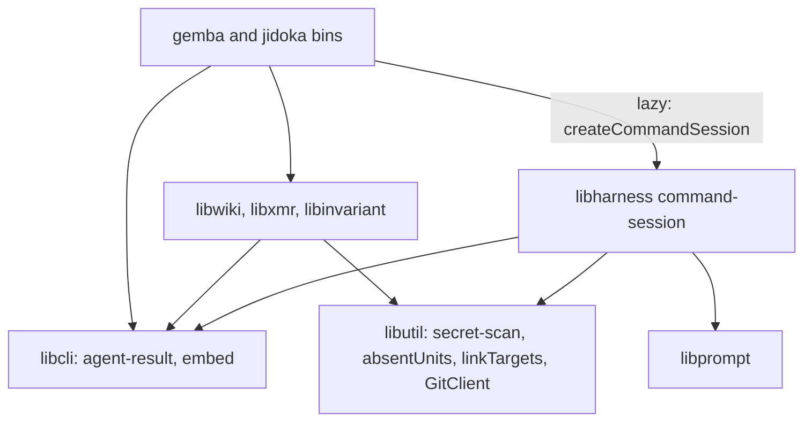

# Design 2410-a: one command session in the runtime, one result contract in the CLI layer, and the judgment as data in each domain library

Spec 2410 turns nine commands into agent-backed commands with one path, gates
that decide, and one result contract. This design fixes the components, the
dependency direction, the session and gate interfaces, the publish flow, the
outcome table, and the removals. It lands after spec 2370's open parts, 2390,
and 2400, and rebases onto them.

## Components

| Component | Home | Role |
| --- | --- | --- |
| Result contract | `libcli`, subpath `agent-result` | The outcomes, exit codes, and `resolveOutcome` (the spec's precedence). The six-field result object, whose `pending` items are `{ id, path, line, reason }`, and its renderer. The reason entry `{ id, outcome, next }` and the base reasons. `agentBacked(importHandler)` wraps a handler entry of a CLI definition. It starts the call budget, loads the handler, renders the result under the command's JSON switch (`--format json`, or `jidoka`'s global `--json`), writes the model, the cost, and the trace path under `--verbose`, and returns the `{ ok, code }` envelope that the gemba bins' shared tail reads. `jidoka`'s tail maps the same envelope. |
| Removed forms | `libcli`, main entry | A command definition may declare its removed subcommands and options with their replacements. `Cli.parse` checks them before its strict parse, beside its rewrite of unknown-option errors, and exits 2 with the new form. A removed subcommand matches only as the first argument after the command name. |
| Command session | `libharness`, subpath `command-session` | `createCommandSession(runtime, promptRoot)` binds the `createDefaultRuntime` bag and a `libprompt` loader once, and each bin calls it lazily. Its `runAgentCommand(brief, drive)` refuses a drive that returns before its first `session.ask(question, task, gate)`, unless the return carries a spec § A2 refusal. Each `ask` is one SDK query with that question's schema. Its rounds go in by streaming input, and a refused proposal goes back for up to three rounds. Before the first query the session refuses an environment with no API key or cloud credential, and it refuses an init message whose `apiKeySource` is `oauth`, both as `credentials`. It scans each task part with its source path, enforces the limits, and writes the run trace to a per-user directory that it creates or checks for its owner and mode 0700. |
| SDK options | `libharness`, the command session | Its own system prompt from the brief, the fast model constant, `permissionMode: "dontAsk"`, `tools` set to the editor's built-in tools or `[]`, and `allowedTools` set to those tools, the reader's `mcp__` trace tool names, and the structured-output tool. `settingSources: []`, `skills: []`, `strictMcpConfig: true`, auto-memory off, `persistSession: false`, and for an editor `cwd` at its stage. A PreToolUse hook denies paths outside the read and write sets. A PostToolUse hook scans each tool output, and on a finding it withholds the output, stops the agent, and ends the call in `blocked`. |
| Editor stage | `libharness`, the command session | The stage lives under the repository's git directory, on the tree's filesystem. It mirrors the read and write sets with the `.claude` segment mapped to a plain name, and the gates resolve links through the same map. The copy-back renames each kept file into place after it checks that the target still matches its snapshot. A changed target refuses its group. |
| SDK helpers | `libharness` | The executable lookup, which refuses a missing runtime or one older than the version the SDK pins as `agent-unavailable`. The usage check and the redacted trace writer. `AgentRunner` and its seven callers share them and keep their protocol. |
| Secret scan | `libutil`, subpath `secret-scan` | `scanText`, `scanFiles`, and the commit-range scan that moves from `libwiki`, over gitleaks. They return each finding with its source path, and the scanner state, and each caller maps them to reasons. A caller passes an allow rule. `libwiki`'s rule reads `FIT_WIKI_SECRET_OVERRIDE`, admits findings in wiki files only, and writes the override record, which names the model provider, into the wiki write set. |
| Shared primitives | `libutil` | `absentUnits(before, after, split, norm)` replaces `libwiki`'s `normalizedKeySet`. Each caller passes its normalizer: the tier-1 probe keeps `libwiki`'s `normLine`, and the `gemba-wiki fix` gate passes one that folds case, spacing, punctuation, and number format. `linkTargets` and `blankCode` move out of the `instruction-links` invariant, which imports them, as does `jidoka fix`. |
| Git client | `libutil`, `GitClient` | New methods for the replay: `mergeTree` (`merge-tree --write-tree --merge-base`, which merges under the wiki's attributes), `commitTree`, and `updateRef` with the old value. A per-call timeout serves the 15-second network limit. Each method has its `libmock` entry. |
| Prompt assets | `libcli`, embed module | `assetDir(metaResolve, relative)` takes the caller's resolver and returns the embedded or installed directory, beside `embeddedDir`. |
| Briefs, handlers, gates, appliers | `libwiki`, `libxmr`, `libinvariant`, `libharness` (`ask`) | Each handler holds its input checks, brief, drive, gates, and writers, and receives `runAgentCommand` from its bin. A gate receives the proposal, the question's tool results, and for an editor the touched paths and the manifest, and it returns a verdict per item. `jidoka fix` lives in `libinvariant`. `libxmr` holds the metrics row writer and the metrics-reference reader. Each library ships `.prompt.md` files. |
| Publish flow | `libwiki` | A `Publisher` module runs § Publishing and replaces `WikiSync.commitAndPush`. `WikiSync` keeps `fetch`, `pull`, and `init`. The `gemba-wiki` bin calls `completePendingSync()` before every command, inside the call budget for an agent-backed one. `push --stop-hook` reads the hook input unless stdin is a terminal, runs the push, and exits 2 on `needs-human` and `blocked` unless `stop_hook_active` is set, 0 on `done` and `noop`, and 1 otherwise. |
| Reason tables | `libcli`, the session, `libwiki`, `libxmr`, `libinvariant`, `libharness` | Each home exports `REASONS` as reason entries. `libcli` holds the base reasons, the ids that more than one home raises: `written`, `fixed`, `clean`, `findings-left`, `secret-detected`, `scanner-unavailable`, `time-limit`, and `agent-unavailable`. A command overrides `next` for an id it raises through `NEXT`, which adds no id. A `.jidoka/invariants` rule finds every export, checks that no id appears twice, and runs the shared `next` safety check. A second rule checks that no domain library imports `libharness` or the Agent SDK, as `byok-boundary` does. |
| Trace tools | `libharness` | Overview, turn ranges, one turn, search, tool frequency, one tool, tool calls, commands, paths, errors, reasoning, timeline, stats, compare, totals, and cost. Lists are paged, and thinking signatures are stripped. Every tool that reports a cost, and the kept `cost` command, share one computation. |
| Test doubles | `libmock` | A scripted session that answers each `ask`, for handler tests. `createMockAgentQuery` reads the streaming input per message and sends file effects through the hooks, for session tests. |
| Actions | `gemba-wiki`, `gemba-bootstrap`, `kata-agent`, `kata-interview` | The `gemba-wiki` action gains an `anthropic-api-key` input and a quoted free-text input, and loses `IS_SANDBOX`. Each action that carries the new binaries or the key releases under a new major. |
| Jidoka install | `jidoka` package | `@forwardimpact/libharness` is an optional peer dependency, so a checks-only install pulls no runtime. `jidoka fix` without it ends in `failed` (`agent-unavailable`), and `next` names the `npx -p` form that adds it. |

## Dependency direction

The main entries of `libcli` and `libutil`, which every CLI loads, carry no
agent terms. Briefs and verdicts are plain objects. `libwiki` drops its
`libharness` dependency, and its edge to `libxmr` carries the row writer.

## Agent kinds

| Kind | Commands | Tools | Writes | Limit |
| --- | --- | --- | --- | --- |
| Proposer | `push`, `log`, `inbox`, `memo`, `claim`, `record` | None. The task carries the context. | None. The applier writes the accepted proposal. | 30 s per question, 60 s per call |
| Reader | `ask` | The trace tools only | None | 120 s per run |
| Editor | `jidoka fix`, `gemba-wiki fix` | Read, Glob, Edit, and Write | Its stage of the named files. `jidoka fix` may add a reference file in a named skill directory. | 180 s per run |

Every command asks at least once: `claim` asks its overlap question with no
candidates, `inbox` asks on an empty inbox, and a fix asks on a clean tree.
The completeness gate refuses an item with no answer. For an editor, the
manifest maps each touched file to findings. Findings that share a file form a
group, and a touched file that the manifest leaves out forms a refused group.
Each group still refused after three rounds returns to its snapshot. The
gates then run on the stage, and each kept group that fails returns too, until
no kept group fails. The handler then copies the kept groups into place.

## Data flow

## Publishing

`push` asks the body question and, on a conflict that `mergeTree` leaves, the
resolver question. `claim` runs steps 1 and 2 and its local same-id check,
asks its overlap question, then runs steps 3 and 5 to 7 for its row commit.
The replay applies a `claim` or `release` row to the tip's claims table by
code, so that table never reaches the resolver. Another agent's claim on the
same id on the tip ends `claim` in `blocked` (`claim-taken`). A conflict
outside the row leaves the row local for the next push, and ends `claim` in
`failed` (`row-deferred`) and `release` in exit 1. Every lock holder runs
under the 110-second budget. Each step starts only while its own limit still
fits, else the call ends in `failed` (`time-limit`).

1. A lock file under the wiki's `.git`, made by exclusive create, records the
   holder's process and start time. A publish that finds a live holder ends in
   `failed` (`clone-busy`), and `pull` exits 1, and both write nothing. A
   holder whose process has gone, or one older than 110 seconds, is stale. A
   caller renames a stale lock away, then takes the lock by exclusive create,
   so two callers cannot both win. `completePendingSync()` takes the lock, and
   it skips under a live holder.
2. The guards run: a merge or rebase in progress, a detached head, and
   ancestry, which reaches the remote once. Each git network call has a
   15-second limit.
3. The flow scans the write set's changes, and a finding ends the call in
   `blocked` with nothing committed. `push` then commits the write set under
   the fixed subject when one exists.
4. The body question runs. With nothing outgoing it still runs, and the call
   ends in `noop`. Otherwise the newest outgoing commit under the fixed
   subject, if any, takes the body.
5. The flow fetches, then replays each local commit not on the remote onto the
   tip with `mergeTree`, in order, each with its own subject. The union driver
   still merges the metrics CSVs. A named ledger row that still conflicts ends
   the call in `needs-human` (`ledger-row-conflict`), as spec 2390 decides.
   Each other conflicted file goes to the resolver question, whose gate
   applies the merge rules of spec § B. A claim row that a push carries and
   that the tip holds for another agent on the same id is dropped, the rest
   lands, and the call ends in `needs-human` (`claim-dropped`).
6. The marker, secret, budget, conservation, and ancestry gates run on the
   replayed tree. The flow writes the pending-sync marker under `.git` with
   the new commit, moves the local branch with `updateRef` against its old
   value, and pushes. A rejected push replays once more, with the resolver for
   new conflicts. A second rejection ends in `failed` (`rejected`).
7. The sync runs only when the branch holds the marker's commit, and otherwise
   it deletes the marker. It brings the index and the working tree to the new
   commit. A path with uncommitted foreign work takes a three-way merge onto
   that work. A conflict there leaves the work as it was, and the marker
   records the path. Later commands proceed, and only a push whose write set
   holds a recorded path ends in `needs-human` (`residue-conflict`).

## Outcomes

| Outcome | Exit | Reason ids |
| --- | --- | --- |
| `done` | 0 | `written`, `fixed`, `answered`, `landed` |
| `noop` | 0 | `clean`, `nothing-to-push`, `no-wiki`, `claim-held`, `inbox-empty`, `no-roster` |
| `failed` | 3 | `credentials`, `agent-unavailable`, `scanner-unavailable`, `model-error`, `time-limit`, `schema-retries`, `turn-limit`, `network`, `remote-unverifiable`, `rejected`, `clone-busy`, `marker-scan-failed`, `wiki-missing`, `row-deferred` |
| `needs-human` | 4 | `findings-left`, `unresolved`, `gate-retries`, `both-sides-line`, `overlap-judged`, `claim-dropped`, `ledger-row-conflict`, `residue-conflict`, `budget`, `mid-rebase`, `mid-merge`, `detached-head`, `would-publish-markers`, `conservation` |
| `blocked` | 5 | `secret-detected`, `unrelated-history`, `claim-taken` |

## Key decisions

| Decision | Choice | Rejected | Why |
| --- | --- | --- | --- |
| Who writes | Proposers and the reader write nothing. Editors write a stage, and the handler copies the kept groups into place. | Every agent edits files. Editors edit the tree in place. | The writers already pass the audit. Sessions can refuse writes under `.claude/**`, and a stage leaves the tree whole on any stop. |
| Session shape | The handler drives a scope and asks questions. | A fixed context, steps, then apply skeleton. | `push` fetches and replays between its two questions. |
| Session class | A command session over shared SDK helpers. | Extend `AgentRunner`. | Seven callers use `run` and `resume`, and a second protocol in one class would serve neither. |
| One query per question | Each question opens a query with its schema. | One query per call. | The SDK binds the output schema once per query. |
| Permission mode | `dontAsk` with an allowlist and the two hooks. | `bypassPermissions`. A permission callback. | `dontAsk` refuses any tool not on the list and runs on a root host. Bypass mode skips the callback and refuses root. A callback would hold a second copy of the hook's path rule. |
| Injection | The bins inject the command session. | Libraries import `libharness`. | An import puts the SDK under `libxmr` and the `jidoka` checks. |
| Contract home | A `libcli` subpath for agent-backed code, and scans that return findings. | The main `libcli` entry. A `libutil` contract. | `libcli` owns exit codes. The entries that every CLI loads carry no agent terms. |
| Reason homes | Each home exports the entries it raises, and one rule checks the union. | One table in the contract subpath. | One table would make `libcli` name every domain's reasons and change with each command. |
| Removed forms | Declared in each command definition and checked by the parser. | A guard that scans the raw arguments. | The parser already rewrites option errors, and a definition ties each removed option to its own command. |
| Merge seam | Replay with `merge-tree`, then sync with a marker. | Resolve in a stopped rebase. `merge-file` in a temporary index. | A kill mid-rebase blocks every later push. `merge-file` ignores the wiki's attributes, so the CSV union would be lost. |
| Git calls | New `GitClient` methods. | Private git calls in `libwiki`. | `GitClient` carries the auth header, the error type, and the test double for every git call. |
| Lock | A lock file made by exclusive create. | An OS advisory lock. Wait for the holder. | Node has no advisory lock call, and the file holds the data that the stale rule reads. A wait cannot fit the hook timeout. |
| Reader tools | In-process trace tools with structured results. | Read and Grep over the trace files. | The number gate checks each number against a tool result, and raw trace lines do not fit the reader's limit. |
| Secret scan | Two owners: the session for model input and the publish gate for what leaves. | `libsecret`. The `libharness` redactor. Whole read roots. | `libsecret` generates secrets. The redactor masks known literals. Old findings in sealed logs would block every run. |
| Prompt home | `.prompt.md` files through `libprompt`. | JS modules. Agent profiles. | The repository embeds prompt files this way. A Jidoka-only repository has no profiles. |
| Jidoka runtime | An optional peer dependency. | A hard dependency. A separate fix package. | Check users keep a light install, and a second package would split one product. |

## Removals

| Removed | Replaced by |
| --- | --- |
| `fix`'s private loop, round cap, task builders, profile prompt, its exits that skip the agent, and `libwiki`'s `libharness` dependency | The session and the `fix` brief. The rotation pre-pass stays. |
| The flag parsers and options that spec § C lists, the old exit codes, and the `gemba-wiki` bin's pre-dispatch exit on a missing wiki | The free-text argument, the appliers, the removed forms, and the result contract |
| `product-mix`'s subprocess call, and `claim.js`'s `pushWiki`, `pushRowOrRefuse`, `notPublishedMessage`, `UNSAFE_STATE_REASONS`, and `NOT_PUBLISHED` | The `libxmr` row writer and the publish table |
| The nineteen query handlers, the query text renderer, `--signatures`, and the `TraceQuery` methods `init`, `filter`, `count`, `head`, and `tail` | `ask` and the trace tools |
| `WikiSync.commitAndPush` with its `reapply` option, `refusalEnvelope`, `PUSH_REASONS`, `WikiSyncRefusal`, `WikiPushFailure`, `AncestryRefusal`, `WikiSyncConflict`, the rebase-and-autostash reconcile, `#reapplyLoop` with `maxReapply`, the singleton check with `SINGLETON_PATHS`, `exemptSummaryFiles`, and the ids `conflict`, `reapply-bound`, `stranded-merge`, `transport`, `precondition`, and `introduced-scan-failed` | The `Publisher`, its table, the replay, and the sync. The post-push tier-1 probe stays, and its detections go into `facts`. |
| `GitClient.resetSoft`, `checkoutPaths`, `mergeOursStrategy`, `mergeAbort`, `stashDropBySha`, the `autostash` and `strategy` options of `rebase`, and their `libmock` entries | The new `GitClient` methods |
| `FIT_WIKI_SCANNER_ABSENT_OK` and the `scanner-absent` override kind, the stale `-X ours` JSDoc, `libwiki`'s private `scriptedQuery`, the `gemba-wiki` action's `IS_SANDBOX` with its line in `.github/CLAUDE.md`, and the justfile `wiki-push` recipe | A scanner on every host, the replay, the `libmock` doubles, `dontAsk`, and the Stop-hook mode |
| Every removed form and old exit code in the callers that spec § Scope lists | The new command lines |

## Contracts outside the components

| Contract | What it needs |
| --- | --- |
| Instruction budgets | The `gemba-wiki` skill sits at its line cap, and the `gemba-xmr` skill one word under its word cap. Both shrink, because their option tables and the writer imports go. `jidoka instructions` is the proof. |
| Specs 2370, 2380, 2390, 2400 | The 2370 release train lands first. The lock covers shared checkouts until 2380 lands. `--remove` and 2390's ledger-row rule hold, and 2390's changelog takes two entries. `memo` reads 2400's roster, and its hooks reference calls `push --stop-hook`. |
| Release chain | The first merge publishes the libraries, `gemba`, `jidoka`, and a gear release, then the four actions under new majors and every repin. The second merge moves the instructions. |
| Follow-ups | Issues filed at plan time for the staff engineer: the advisor and the judge onto the command session, `pull` onto the replay, `libterrain`, `libcodegen`, and `libpack` onto `assetDir` and `linkTargets`, and the removed forms out after their two releases. |

## Risks

| Risk | Mitigation |
| --- | --- |
| `dontAsk` might refuse the structured-output tool or the trace tools, `tools: []` might remove the structured-output tool, or a PostToolUse hook might not replace every output. | A live session test in the first plan part covers each case before any command ships. |
| Managed policy settings can carry hooks, and a credential kept only in Claude Code settings does not reach the agent. | Spec § A6 states both. The host exports the credential to the environment. |
| A stop during the copy-back leaves some kept groups in place and others not. | Each file moves by rename, and the next fix run audits the tree again. |
| A model update changes the judgment. | The gates bound every write, and the scripted tests pin each outcome. |
