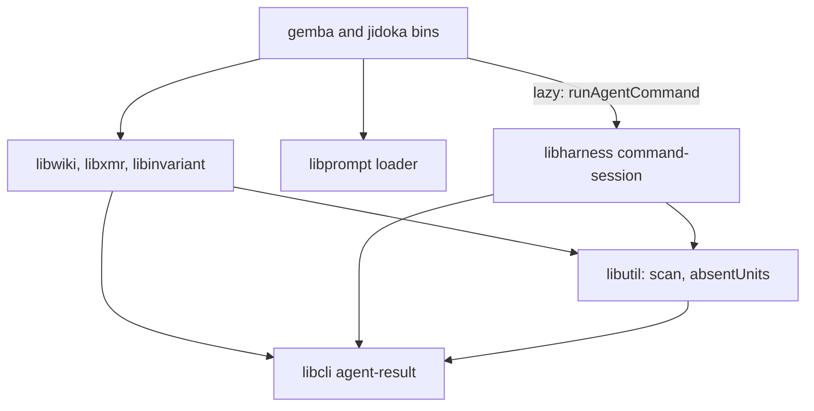
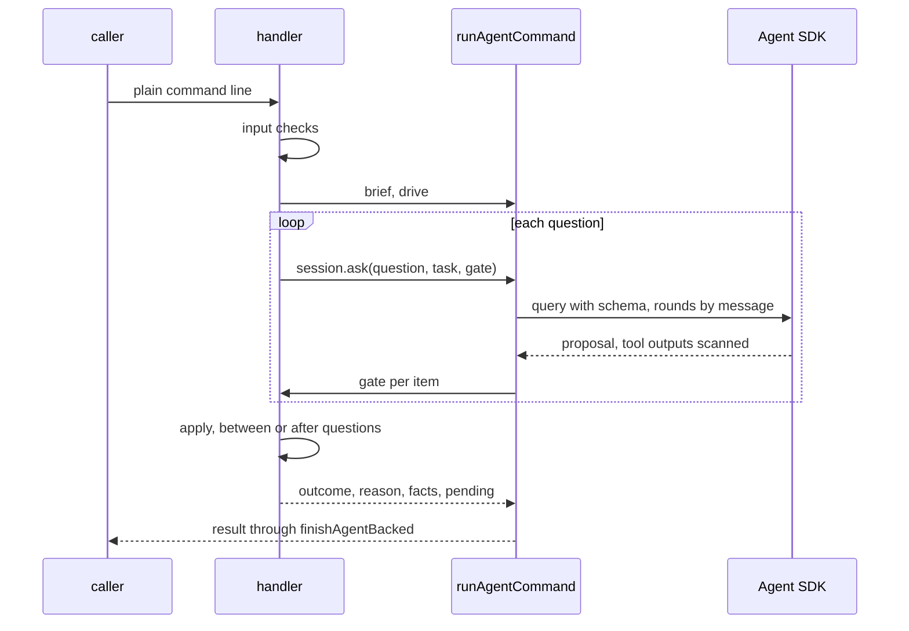

# Design 2410-a: one command session in the runtime, one result contract in the CLI layer, and the judgment as data in each domain library

Spec 2410 turns nine commands into agent-backed commands with one path, gates
that decide, and one result contract. This design fixes the components, the
dependency direction, the session and gate interfaces, the publish flow, the
outcome table, and the removals. It lands after spec 2370's open parts, 2390,
and 2400, and rebases onto them.

## Components

| Component | Home | Role |
| --- | --- | --- |
| Result contract | `libcli`, subpath `agent-result` | The outcomes, exit codes, and `resolveOutcome` (the spec's precedence). The six-field result object, whose `pending` items are `{ id, path, line, reason }`, and its renderer (`next` to stderr). The base reasons that two or more libraries raise (`written`, `answered`, `fixed`, `clean`, `findings-left`, `unresolved`, `gate-retries`). The removed-forms table that each CLI definition fills and the parser checks before dispatch, by position. The `--verbose` and `--format` option objects that a definition attaches. `finishAgentBacked(loader)`, the bin tail. Only agent-backed bins import the subpath. |
| Command session | `libharness`, subpath `command-session` | `runAgentCommand(brief, drive)` calls `drive(session)` and refuses a drive that returns before one `session.ask(question, task, gate)`. Each `ask` is one SDK query with that question's schema, and its rounds go in by streaming input. The session scans every text, enforces the limits and the call budget, records the paths the agent touches, restores them on refusal, writes the run trace, and maps SDK failures through its reason table. |
| SDK options | The command session | Its own system prompt from the brief, the fast model constant, `permissionMode: "dontAsk"`, `allowedTools` equal to the `tools` allowlist plus the structured-output tool, `settingSources: []`, `skills: []`, `strictMcpConfig: true`, auto-memory off, and `persistSession: false`. A PreToolUse hook denies paths outside the read and write sets. A PostToolUse hook scans every tool output and withholds a finding. The reader's trace tools are the one MCP server, in-process. |
| SDK helpers | `libharness` | The executable lookup, the zero-usage credential check, and the redacted trace writer, shared by `AgentRunner` and the command session. `AgentRunner` and its six callers keep their protocol. |
| Secret scan | `libutil` | `scanText`, `scanFiles`, and the commit-range scan that moves from `libwiki`, over gitleaks, with the scan reasons. A caller passes an allow rule. `libwiki`'s rule reads `FIT_WIKI_SECRET_OVERRIDE` and writes the override record, which names the model provider, into the wiki write set. |
| Shared primitives | `libutil` and `libinvariant` | `absentUnits(before, after, split)` and `normLine` in `libutil`, which replace `libwiki`'s `normalizedKeySet`. The code-blanking link extractor moves from the repository invariant into `libinvariant`, and the invariant imports it. `libpack` keeps its own extractor. |
| Briefs, handlers, gates, appliers | `libwiki`, `libxmr`, `libinvariant`, `libharness` (`ask`) | Each handler holds its input checks, brief, drive, gates, and writers. A gate receives the proposal, the question's tool results, and for an editor the touched paths and the manifest, and it returns a verdict per item. `jidoka fix` lives in `libinvariant`, and its bin entry is thin. `libxmr` holds the metrics row writer and the metrics-reference reader. Each library ships `.prompt.md` files. |
| Prompt loading | The bins | The CLI layer resolves each library's prompt directory, embedded or installed, and injects a `libprompt` loader into the session, as `fit-terrain` does. `build/cli-manifest.json` gains the asset mounts for the four binaries. |
| Publish flow | `libwiki` | § Publishing, behind one reason table. `completePendingSync()`, which the `gemba-wiki` bin calls before every command. `push --stop-hook`. |
| Trace tools | `libharness` | Overview, turn ranges, one turn, search, tool frequency, one tool, tool calls, commands, paths, errors, reasoning, timeline, stats, compare, totals, and cost. Lists are paged, and thinking signatures are stripped. |
| Test doubles | `libmock` | A scripted session that answers each `ask`, for handler tests. `createMockAgentQuery` reads the streaming input per message and sends file effects through the hooks, for session tests. |
| Actions | `gemba-wiki`, `gemba-bootstrap`, `kata-agent`, `kata-interview` | The `gemba-wiki` action gains an `anthropic-api-key` input and a quoted free-text input. Each action that carries the new binaries or the key releases under a new major. |

## Dependency direction

No domain library imports `libharness` or the Agent SDK. Briefs and verdicts
are plain objects. `libwiki` drops its `libharness` dependency, and its edge
to `libxmr` carries the row writer.

## Agent kinds

| Kind | Commands | Tools | Writes | Limit |
| --- | --- | --- | --- | --- |
| Proposer | `push`, `log`, `inbox`, `memo`, `claim`, `record` | None. The task carries the context. | None. The applier writes the accepted proposal. | 30 s per question, 60 s per call |
| Reader | `ask` | The trace tools only | None | 120 s per run |
| Editor | `jidoka fix`, `gemba-wiki fix` | Read, Glob, Edit, and Write | Named files, and new files in named directories | 180 s per run |

Every command asks at least once: `claim` asks its overlap question with no
candidates, `inbox` asks on an empty inbox, and a fix asks on a clean tree.
The completeness gate refuses an undecided input id. For an editor, the
manifest maps each touched file to findings, findings that share a file form a
group, and a touched file that the manifest leaves out forms a refused group.
Refused groups go back with their reasons for up to three rounds. Each group
still refused then returns its touched files to the snapshot that the session
takes after any pre-pass, and deletes files it created. The gates then run once
on the final tree, and a kept group that now fails is restored the same way.

## Data flow

The session scans what goes to the model, and the publish gate scans what
leaves for the wiki, the commit body included. Run traces go to a per-user
directory of mode 0700 under the system temporary directory, with files of
mode 0600, and the session deletes files there older than one day.

## Publishing

`push` asks the body question and, on a prose conflict, the resolver question.
`claim` runs steps 1 and 2, then asks only its overlap question. Its row
operation resolves the claims in the replay, and a conflict elsewhere ends
`claim` in `needs-human` (`row-conflict`) and `release` in exit 1.

1. A lock file under the wiki's `.git` records the holder's process and start
   time. A publish that finds a live holder ends in `failed` (`clone-busy`)
   and writes nothing. A holder whose process has gone, or one older than the
   110-second call budget, is broken. `completePendingSync()` skips while a
   live holder holds the lock. `pull` takes the lock and keeps its rebase
   reconcile, which is out of scope.
2. The guards run: a merge or rebase in progress, a detached head, and
   ancestry, which reaches the remote once. Each git network call has a
   15-second limit.
3. `push` commits the write-set under the fixed subject when one exists.
4. The body question runs. With nothing outgoing it still runs, and the call
   ends in `noop` with no amend. Otherwise the commit from step 3 takes the
   body.
5. The flow fetches, then replays each local commit not on the remote onto the
   tip, in order, each with its own subject, in a temporary index. A file one
   side changed takes that side. A file both changed takes git's three-way
   merge under the wiki's attributes, so the union driver still merges the
   metrics CSVs. A named ledger row that still conflicts ends the call in
   `needs-human`, as spec 2390 decides. Each other file that still conflicts
   goes to the resolver question, whose gate applies the merge rules of spec
   § B. Every claim row the replay carries is checked against the tip.
6. The marker, secret, budget, conservation, and ancestry gates run on the
   replayed tree. The flow writes the pending-sync marker under `.git`, moves
   the local branch with a compare-and-swap ref update, and pushes. A rejected
   push replays once more, with the resolver for new conflicts. A second
   rejection, or a call that reaches its budget before the ref update, ends in
   `failed`.
7. The sync brings the index and the working tree to the new commit. A path
   with uncommitted foreign work takes a three-way merge onto that work. A
   conflict there leaves the work as it was, and the marker records the path.
   Later commands proceed, and only a push whose write set holds a recorded
   path ends in `needs-human` (`residue-conflict`).

## Outcomes

| Outcome | Exit | Reason ids, beside the base reasons |
| --- | --- | --- |
| `done` | 0 | `landed` |
| `noop` | 0 | `nothing-to-push`, `no-wiki`, `claim-held`, `inbox-empty` |
| `failed` | 3 | `credentials`, `scanner-unavailable`, `model-error`, `time-limit`, `schema-retries`, `turn-limit`, `network`, `remote-unverifiable`, `rejected`, `clone-busy`, `marker-scan-failed` |
| `needs-human` | 4 | `both-sides-line`, `overlap-judged`, `residue-conflict`, `budget`, `mid-rebase`, `mid-merge`, `detached-head`, `would-publish-markers`, `conservation`, `row-conflict` |
| `blocked` | 5 | `secret-detected`, `unrelated-history`, `claim-taken` |

The base reasons live in `libcli`, the loop reasons in the session, the scan
reasons in `libutil`, the publish reasons and `no-wiki` in `libwiki`, and each
command's own reasons in its library. Each exports `REASONS`, and a command
sets its own `next` for a base id through `NEXT`, which adds no id. A
repository invariant finds every export, checks that no id appears twice, and
calls the shared `next` safety check, which a test also runs. The publish
table replaces `refusalEnvelope`, `PUSH_REASONS`, `WikiSyncRefusal`,
`WikiPushFailure`, `AncestryRefusal`, and `WikiSyncConflict`. The `release`
handler maps its reasons to its legacy exits.

`gemba-wiki push --stop-hook` reads the hook input unless stdin is a terminal,
runs the push, and exits 2 on exit codes 4 and 5 unless `stop_hook_active` is
set, else 0. `.claude/settings.json`, the justfile `wiki-push` recipe, and the
`kata-setup` hooks reference call it with a 120-second timeout.

## Key decisions

| Decision | Choice | Rejected | Why |
| --- | --- | --- | --- |
| Who writes | Proposers and the reader write nothing. Editors write their sets, gated by finding group. | Every agent edits files. All-or-nothing editor runs. | The writers already pass the audit. One finding the agent cannot fix must not void the rest. |
| Session shape | The handler drives a scope and asks questions, and the scope refuses a drive with no question. | A fixed context, steps, then apply skeleton. | `push` publishes between its two questions. The refusal keeps the every-call rule. |
| Session class | A command session over shared SDK helpers. | Extend `AgentRunner`. | Six harness callers use `run` and `resume`, and a second protocol in one class would serve neither. |
| One query per question | Each question opens a query with its schema. | One query per call. | The SDK binds the output schema once per query. |
| Permission mode | `dontAsk` with an allowlist and the two hooks. | `bypassPermissions`. A permission callback. | `dontAsk` refuses any tool not on the list and runs on a root host. Bypass mode skips the callback and refuses root. |
| Injection | The bins inject `runAgentCommand` and the prompt loader. | Libraries import `libharness`. | An import puts the SDK under `libxmr` and the `jidoka` checks. |
| Contract home | A `libcli` subpath that only agent-backed bins import. | The main `libcli` entry. `libutil`. | `libcli` owns exit codes. A subpath keeps agent terms out of the other CLIs. |
| Merge seam | Replay in a temporary index, then sync with a marker. | Resolve in a stopped rebase. Keep the singleton loop. | A kill mid-rebase blocks every later push. A stale tree would make the next push revert the peers. |
| Lock | A lock file, and a busy clone fails at once. | Wait for the holder. | A wait cannot fit the hook timeout. |
| Stop hook | A `push` mode that ships with `gemba-wiki`. | A justfile recipe. Shell in each settings file. | Every installation runs one tested rule. |
| Secret scan | Two owners: the session for model input and the publish gate for what leaves. | `libsecret`. The `libharness` redactor. Whole read roots. | `libsecret` generates secrets. The redactor masks known literals. Old findings in sealed logs would block every run. |
| Prompt home | `.prompt.md` files through `libprompt`. | JS modules. Agent profiles. | The repository embeds prompt files this way. A Jidoka-only repository has no profiles. |

## Removals

| Removed | Replaced by |
| --- | --- |
| `fix`'s private loop, round cap, task builders, profile prompt, its exits that skip the agent, and `libwiki`'s `libharness` dependency | The session and the `fix` brief. The rotation pre-pass stays. |
| The flag parsers and options that spec § C lists, and the old exit codes | The free-text argument, the appliers, the removed-forms table, and the result contract |
| `product-mix`'s subprocess call, and `claim.js`'s `pushWiki`, `UNSAFE_STATE_REASONS`, and `NOT_PUBLISHED` | The `libxmr` row writer and the publish table |
| The nineteen query handlers, the query text renderer, `--signatures`, and the `TraceQuery` methods `init`, `filter`, `count`, `head`, and `tail` | `ask` and the trace tools |
| The six reason carriers, the rebase-and-autostash reconcile, `#reapplyLoop` with `maxReapply` and the singleton check, the `conflict`, `reapply-bound`, and `stranded-merge` reasons, and `exemptSummaryFiles` | The publish table, the replay, and the sync. The post-push tier-1 probe stays, and its detections go into `facts`. |
| `FIT_WIKI_SCANNER_ABSENT_OK` and the `scanner-absent` override kind, the stale `-X ours` JSDoc, and `libwiki`'s private `scriptedQuery` | A scanner on every host, the replay, and the `libmock` doubles |
| Every removed form and old exit code in the callers that spec § Scope lists | The new command lines |

## Contracts outside the components

| Contract | What it needs |
| --- | --- |
| Instruction budgets | The `gemba-wiki` skill sits at its line cap, and the `gemba-xmr` skill one word under its word cap. Both shrink, because their option tables go. `jidoka instructions` is the proof. |
| Specs 2370, 2380, 2390, 2400 | The 2370 release train lands first. The lock covers shared checkouts until 2380 lands. `--remove` and 2390's ledger-row rule hold, and 2390's changelog takes two entries. `memo` reads 2400's roster, and its hooks reference calls `push --stop-hook`. |
| Release chain | The first merge publishes the libraries, `gemba`, `jidoka`, and a gear release, then the four actions under new majors and every repin. The second merge carries the instructions. |
| Follow-ups | Issues filed at plan time for the staff engineer: the advisor and the judge onto the command session, `pull` onto the replay, and the removed-forms messages out after their two releases. |

## Risks

| Risk | Mitigation |
| --- | --- |
| `dontAsk` might refuse the structured-output tool, or a PostToolUse hook might not replace every output. | A live session test in the first plan part covers both before any command ships. |
| Managed policy settings can carry hooks, and a credential kept only in Claude Code settings does not reach the agent. | Spec § A6 states both. The host exports the credential to the environment. |
| Editor runs may hit their 180-second limit. | `failed` restores the touched paths, and a retry starts fresh. |
| A model update changes the judgment. | The gates bound every write, and the scripted tests pin each outcome. |
