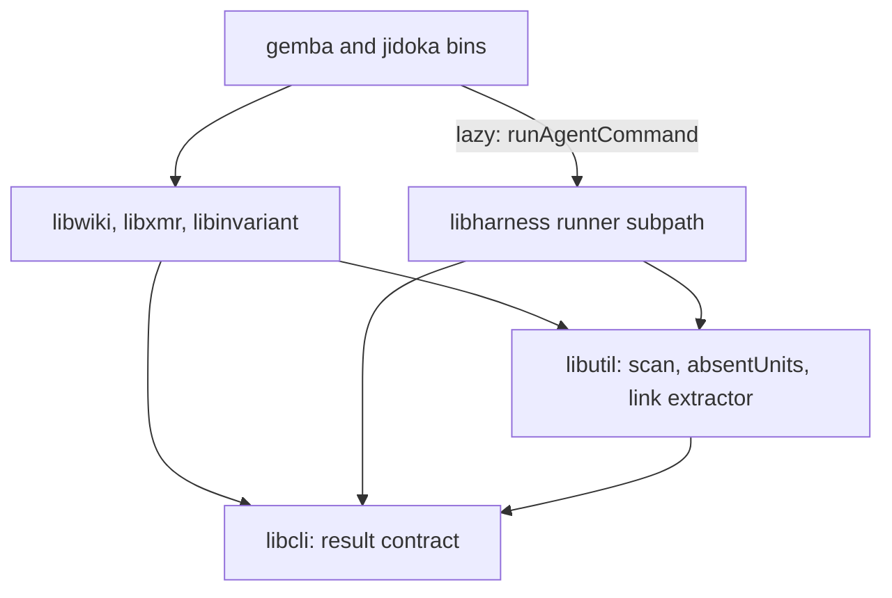
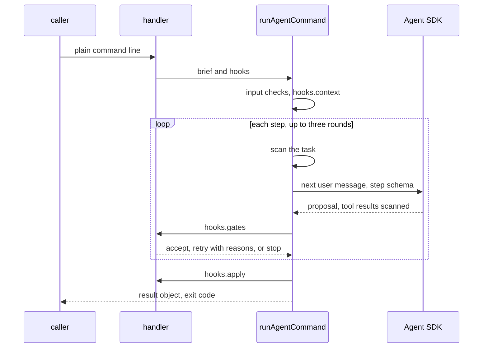

# Design 2410-a: one agent-command runner in the runtime, one result contract in the CLI layer, and the judgment as data in each domain library

Spec 2410 turns nine commands into agent-backed commands with one path, gates
that decide, and one result contract. This design fixes the components, the
dependency direction, the runner and gate interfaces, the publish flow, the
outcome table, and the removals. It lands after specs 2370 (its open parts),
2390, and 2400, and rebases onto them.

## Components

| Component | Home | Role |
| --- | --- | --- |
| Result contract | `libcli` | The outcomes, their exit codes, `resolveOutcome` (the spec's precedence), the reason-table shape (id, outcome, `next`) and a check that ids are unique, the six-field result object and its renderer (`next` to stderr), and an `agentBacked` mark on a command definition. The mark adds `--verbose` to the command, and `--format` to a `gemba-wiki` command. `jidoka` keeps its global `--json`. |
| Agent-command runner | `libharness`, on its own subpath | `runAgentCommand(brief, hooks)` runs one call: the input checks, `hooks.context`, the agent steps with `hooks.gates`, `hooks.apply`, and the result object. A brief is plain data: kind, prompt asset, step schemas, read and write sets, the call budget, and an optional allow rule. A verdict is plain data: `accept`, `retry` with reasons, or `stop` with a reason id. The runner owns the limits, the scans of model input, the editor snapshot and group restore, the run trace, and the loop reason table. |
| Agent runner | `libharness` | Gains the output schema, streaming input for one live session across rounds with `persistSession: false`, the `tools` allowlist, and the `hooks` option. A command agent passes `settingSources: []`, `skills: []`, and no MCP servers. Other callers keep their options. `allowedTools` is documented as approval only. It reports the SDK error kind to the runner's table. |
| Secret scan | `libutil` | `scanText` and `scanFiles` over gitleaks, beside the commit-range scan that moves from `libwiki`. The allow rule comes from the caller. |
| Shared primitives | `libutil` | `absentUnits(before, after, split)`, a set difference over lines or sentences. The markdown link extractor, moved from `libpack`, which then imports it. |
| Briefs, handlers, gates, appliers | `libwiki`, `libxmr`, `libinvariant`, `libharness` (`ask`) | Each handler supplies its brief and hooks, and takes `runAgentCommand` from its deps. Prompts are `.prompt.md` assets that `libprompt` loads, embedded in the binaries. `jidoka fix` lives in `libinvariant` with its gates. `libxmr` holds the metrics row writer and the metrics-reference reader. |
| Wiring | The `gemba` and `jidoka` bins | A bin imports the runner subpath lazily for a command marked `agentBacked`. Other commands keep their tails. The `gemba-wiki` bin hands the no-wiki check to the runner for those commands. |
| Publish flow | `libwiki` | The lock, guards, rebuild, gates, ref update, and sync of § Publishing. One reason table, which also holds `release`'s legacy exit per reason. |
| Trace tools | `libharness` | Read-only in-process tools over the trace query class and the multi-trace aggregates. Every list is paged with a bound and a cursor. |
| Test doubles | `libmock` | `createMockAgentQuery` gains editor file effects. A scripted `runAgentCommand` serves the handler tests. |
| Actions | `gemba-wiki`, `gemba-bootstrap`, `kata-agent`, `kata-interview` | The `gemba-wiki` action gains an `anthropic-api-key` input and a separate input for the free-text argument, which it passes quoted. Each action that carries the new binaries or the key releases under a new major. |

## Dependency direction

No domain library imports `libharness` or the Agent SDK. Verdicts and briefs
are plain objects, so no library needs a shared type module. `libwiki` drops
its `libharness` dependency.

## Agent kinds

| Kind | Commands | Tools | Writes | Limit |
| --- | --- | --- | --- | --- |
| Proposer | `push`, `log`, `inbox`, `memo`, `claim`, `record` | None. The task carries the context. | None. The applier writes the accepted proposal. | 30 s per step, and `push` 60 s per call |
| Reader | `ask` | The trace tools only | None | 120 s per run |
| Editor | `jidoka fix`, `gemba-wiki fix` | Read, Glob, Edit, and Write | Only the files in the write set. A PreToolUse hook denies other paths and scans each file before a read. | 180 s per run |

Each proposal item names the input id it answers, and the completeness gate
refuses a proposal that leaves an id undecided. For an editor, the runner
diffs the write set against the snapshot it takes when it opens, after any
pre-pass. The agent's manifest maps each edited file to findings, and findings
that share a file form one group. An edited file that the manifest leaves out
forms a group that the gates refuse. Refused groups go back to the agent with
their reasons for up to three rounds. After that, each refused group returns
its files to the snapshot and deletes any file it created. A mix of kept and
refused groups ends in `needs-human`.

## Data flow

The runner scans the task, the given input files, and every tool result before
the model sees them. The publish gate scans what leaves for the wiki. Those
are the only two scan owners. The run trace goes to a per-command directory
under the system temporary directory, and the runner deletes files there that
are older than one day.

## Publishing

`push` runs every step. `claim` and `release` commit only their row, skip
steps 4 and 5, and resolve the claims ledger with their row operation; any
other conflict ends in `needs-human`.

1. A lock file records the holder's process and start time. A push waits up
   to 20 s, and breaks a lock whose holder has gone or is older than 120 s. A
   wait that runs out ends in `failed` (`push-busy`).
2. A pending-sync marker from an interrupted push is completed first. Then the
   guards run: a merge or rebase in progress, a detached head, and ancestry,
   which reaches the remote once.
3. The handler commits the write-set when one exists, and folds all local
   commits not on the remote into one.
4. Step one asks for the commit body. With nothing outgoing, the step still
   runs, and the call ends in `noop` with no amend. Otherwise the commit takes
   the body under the fixed subject, and the conservation guard reads only that
   subject.
5. The flow fetches and rebuilds the commit on the fresh tip in a temporary
   index. A file that one side changed takes that side. A file that both
   changed takes git's three-way merge under the wiki's attributes, so the
   union driver still merges the metrics CSVs. Each file that still conflicts
   goes to step two, the resolver. The claim tip check runs after every fetch.
6. The marker, secret, budget, conservation, and ancestry gates run on the
   rebuilt tree. The flow writes the pending-sync marker, moves the branch with
   one ref update, and pushes. A rejected push rebuilds once more. A second
   rejection ends in `failed`.
7. The sync brings the index and the working tree to the new commit. A path
   with uncommitted foreign work takes a three-way merge onto that work, and a
   conflict there leaves the work as it was and ends in `needs-human`
   (`residue-conflict`). The marker goes last.

`pull` keeps its own rebase reconcile, the one other merge path. It is out of
scope.

## Outcomes

| Outcome | Exit | Reason ids |
| --- | --- | --- |
| `done` | 0 | `landed`, `written`, `answered`, `fixed` |
| `noop` | 0 | `nothing-to-push`, `no-wiki`, `claim-held`, `inbox-empty`, `clean` |
| `failed` | 3 | `credentials`, `scanner-unavailable`, `model-error`, `time-limit`, `schema-retries`, `turn-limit`, `transport`, `rejected`, `remote-unreachable`, `push-busy`, `marker-scan-failed` |
| `needs-human` | 4 | `unresolved`, `gate-retries`, `both-sides-line`, `findings-left`, `overlap-judged`, `residue-conflict`, `budget`, `mid-rebase`, `mid-merge`, `detached-head`, `would-publish-markers`, `conservation`, `row-conflict` |
| `blocked` | 5 | `secret-detected`, `unrelated-history`, `claim-taken` |

The runner's table owns the loop reasons, the scan's table the secret and
scanner reasons, the publish table the publish reasons, and each command the
rest. The publish table replaces `refusalEnvelope`, `PUSH_REASONS`,
`WikiSyncRefusal`, `WikiPushFailure`, `AncestryRefusal`, and
`WikiSyncConflict`. A test lists every table, checks that ids are unique, that
each `next` is safe, and that every publish reason has a `release` exit.

The justfile `wiki-push` recipe is the one Stop-hook home, and
`.claude/settings.json` calls it with a 120-second timeout. It reads
`stop_hook_active` from stdin unless stdin is a terminal. It exits 2 on push
exits 4 and 5 unless that flag is set, and 0 otherwise.

## Key decisions

| Decision | Choice | Rejected | Why |
| --- | --- | --- | --- |
| Who writes | Proposers and the reader write nothing. Editors write their write set, gated by finding group. | Every agent edits files. All-or-nothing editor runs. | The writers already pass the audit. One finding the agent cannot fix must not void the rest. |
| Injection | The bins inject `runAgentCommand`, the whole call skeleton. | Inject a raw session. Libraries import `libharness`. | Nine handlers would repeat the same skeleton. An import puts the SDK under the `jidoka` checks and `libxmr`. |
| Contract home | Outcomes and the result object in `libcli`. Briefs, verdicts, and limits stay plain data in the runner. | All of it in `libcli`. All of it in `libutil`. | `libcli` already owns exit codes. Agent terms do not belong in the library every CLI loads. |
| Gate verdict | `accept`, `retry`, or `stop`. | Accept or refuse. | A safety refusal must end the call at once. |
| Tool control | The `tools` allowlist and a PreToolUse path hook. | A permission callback. | The runner pins bypass mode, and the SDK never calls the callback there. |
| Live session | Streaming input, one query, `persistSession: false`. | Resume plus `deleteSession`. Move `CLAUDE_CONFIG_DIR`. | No transcript lands on disk, even when a kill stops the call. The config directory holds the local login. |
| Merge seam | Rebuild in a temporary index, then sync the working tree. One rebuild for push, claim, and release. | Resolve inside a stopped rebase. Keep the singleton loop. | A kill mid-rebase blocks every later push. A stale tree would make the next push revert the peers. |
| Lock | A lock file with the holder and its start time. | No lock. A git ref lock. | A shared checkout runs pushes in parallel until spec 2380 lands. A file shows a dead holder. |
| Secret scan | `libutil`. The runner scans model input, and the publish gate scans what leaves. | `libsecret`. The `libharness` redactor. Whole read roots. | `libsecret` generates secrets. The redactor masks known literals in traces. Old findings in sealed logs would block every run. |
| Prompt home | `.prompt.md` assets through `libprompt`. | JS modules. Agent profiles. | The repository already embeds prompt assets this way. A Jidoka-only repository has no profiles. |
| Exit codes | 0, 0, 3, 4, 5. Exit 1 stays for an unexpected error. | 1 for `failed`. | A crash must not look like a retryable failure. |
| Model | The fast model constant. | A larger model for `ask`. | One constant to measure first. |

## Removals

| Removed | Replaced by |
| --- | --- |
| `fix`'s private loop, round cap, task builders, profile prompt, its exits that skip the agent, and `libwiki`'s `libharness` dependency | The runner and the `fix` brief |
| The flag parsers and options that spec § C lists, and the old exit codes | The free-text argument, the appliers, and the result contract |
| `product-mix`'s subprocess call to `gemba-xmr record` | The `libxmr` row writer |
| The nineteen query handlers, the query text renderer, and `--signatures` | `ask` and the trace tools. The trace query class stays whole. |
| The six reason carriers, the rebase-and-autostash reconcile, `#reapplyLoop` with `maxReapply` and the singleton check, the `conflict`, `reapply-bound`, and `stranded-merge` reasons, and `exemptSummaryFiles` | The publish table, the rebuild, and the sync |
| `FIT_WIKI_SCANNER_ABSENT_OK` and its audit entry kind | A scanner on every host |
| The stale `-X ours` JSDoc and `libwiki`'s private `scriptedQuery` | The rebuild and the `libmock` doubles |
| Every removed form and old exit code in skills, profiles, actions, READMEs, tests, audit hints, help examples, pages, scripts, benchmarks, the justfile, and `package.json` | The new command lines |

## Contracts outside the components

| Contract | What it needs |
| --- | --- |
| Instruction budgets | The `gemba-wiki` skill sits at its line cap, and the `gemba-xmr` skill one word under its word cap. Both shrink, because their option tables go. `jidoka instructions` is the proof. |
| Specs 2370, 2380, 2390, 2400 | The 2370 release train lands first. The lock covers shared checkouts until 2380 lands. `--remove` stays a `push` input. `memo` reads 2400's roster, and one setup changelog entry brings the Stop-hook rule to installations. |
| Release chain | First merge: `libcli`, `libutil`, `libpack`, `libharness`, `libwiki`, `libxmr`, `libinvariant`, and `libmock` publish, then `gemba` and `jidoka`, a gear release, the four actions under new majors, and the repins of every pin. Second merge: skills, profiles, protocol, and pages. |
| Follow-ups | One issue, filed at plan time for the staff engineer, moves the advisor and the judge onto the runner. |

## Risks

| Risk | Mitigation |
| --- | --- |
| A PreToolUse deny might not hold in bypass mode, or an empty `tools` list might drop the structured-output tool. | A live runner test in the first plan part covers both. If either fails, the runner gains a permission-mode option for command agents only, set to `dontAsk`. |
| Managed policy settings can carry hooks that still run. | Spec § A6 states it. An administrator's hooks are the administrator's choice. |
| A credential kept only in Claude Code settings does not reach the agent. | Spec § A6 states it. The host exports it to the environment. |
| Editor runs may hit their 180-second limit. | `failed` keeps the snapshot, and a retry starts fresh. |
| A model update changes the judgment. | The gates bound every write, and the scripted tests pin each outcome. |
