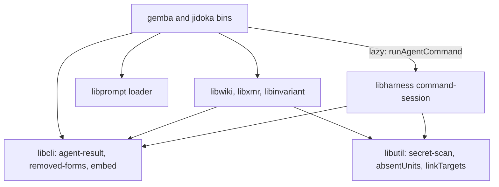
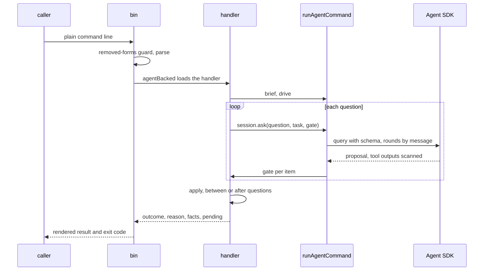

# Design 2410-a: one command session in the runtime, one result contract in the CLI layer, and the judgment as data in each domain library

Spec 2410 turns nine commands into agent-backed commands with one path, gates
that decide, and one result contract. This design fixes the components, the
dependency direction, the session and gate interfaces, the publish flow, the
outcome table, and the removals. It lands after spec 2370's open parts, 2390,
and 2400, and rebases onto them.

## Components

| Component | Home | Role |
| --- | --- | --- |
| Result contract | `libcli`, subpath `agent-result` | The outcomes, exit codes, and `resolveOutcome` (the spec's precedence). The six-field result object, whose `pending` items are `{ id, path, line, reason }`, and its renderer (`next` to stderr). The reason entry `{ id, outcome, next }` and the base reasons that more than one home raises. The `--verbose` and `--format` option objects. `agentBacked(importHandler)` wraps one entry of a bin's dispatch map: it loads the handler, renders its result, and sets the exit code. The bin's other entries keep their own tail. |
| Removed forms | `libcli`, subpath `removed-forms` | A guard that a bin calls on the raw arguments before `cli.parse`, as it calls `server-flags`. It matches a removed subcommand only as the first argument after the command name, and each removed option anywhere, and exits 2 with the new form. `release --target` uses it too. |
| Command session | `libharness`, subpath `command-session` | `runAgentCommand(brief, drive)`, with `clock`, `fs`, and the query function pre-bound by the bin. The call budget starts here. A drive may return before its first `session.ask(question, task, gate)` only with a spec § A2 refusal reason. Each `ask` is one SDK query with that question's schema, and its rounds go in by streaming input. The session scans every text, enforces the limits and the budget, writes the run trace, and maps SDK failures through its reason table. For an editor it owns the stage, the group rounds, and the final gate pass. The session scans what goes to the model, and the publish gate scans what leaves for the wiki, the commit body included. Run traces go to a per-user directory under the system temporary directory. The session creates it with mode 0700, or checks that the user owns it with that mode, writes files of mode 0600, and deletes files there older than one day. |
| SDK options | `libharness`, the command session | Its own system prompt from the brief, the fast model constant, `permissionMode: "dontAsk"`, `tools` set to the editor's built-in tools or `[]`, and `allowedTools` set to those tools, the reader's `mcp__` trace tool names, and the structured-output tool. `settingSources: []`, `skills: []`, `strictMcpConfig: true`, auto-memory off, `persistSession: false`, and for an editor `cwd` at its stage. A PreToolUse hook denies paths outside the read and write sets. A PostToolUse hook scans each tool output, and on a finding it withholds the output, stops the agent, and ends the call in `blocked`. |
| SDK helpers | `libharness` | The executable lookup, which raises `agent-unavailable` when no runtime resolves, the zero-usage credential check, and the redacted trace writer, shared by `AgentRunner` and the command session. `AgentRunner` and its seven callers keep their protocol. |
| Secret scan | `libutil`, subpath `secret-scan` | `scanText`, `scanFiles`, and the commit-range scan that moves from `libwiki`, over gitleaks. They return findings and the scanner state, and each caller maps them to reasons. A caller passes an allow rule. `libwiki`'s rule reads `FIT_WIKI_SECRET_OVERRIDE`, covers wiki files only, and writes the override record, which names the model provider, into the wiki write set. |
| Shared primitives | `libutil` | `absentUnits(before, after, split, norm)` replaces `libwiki`'s `normalizedKeySet`. Each caller passes its normalizer: the tier-1 probe keeps `libwiki`'s `normLine`, and the `gemba-wiki fix` gate passes one that folds case, spacing, punctuation, and number format. `linkTargets(text, { blankCode })` is the one link extractor. The invariant and `jidoka fix` blank code, and `libpack` keeps links in code on purpose. |
| Prompt assets | `libcli` embed module | `promptDir(packageName)` resolves a library's prompt directory, embedded or installed, beside `embeddedDir`. Each bin passes a `libprompt` loader over it into the session. `build/cli-manifest.json` gains the asset mounts for the four binaries. |
| Briefs, handlers, gates, appliers | `libwiki`, `libxmr`, `libinvariant`, `libharness` (`ask`) | Each handler holds its input checks, brief, drive, gates, and writers, and receives `runAgentCommand` from its bin. A gate receives the proposal, the question's tool results, and for an editor the touched paths and the manifest, and it returns a verdict per item. `jidoka fix` lives in `libinvariant`. `libxmr` holds the metrics row writer and the metrics-reference reader. Each library ships `.prompt.md` files. |
| Publish flow | `libwiki` | § Publishing, behind one reason table. The replay uses private git calls beside `GitClient`: a temporary index, `merge-file`, and `update-ref` with the old value. `completePendingSync()`, which the `gemba-wiki` bin calls before every command. `gemba-wiki push --stop-hook` reads the hook input unless stdin is a terminal, and runs the push. It exits 2 on exit codes 4 and 5 unless `stop_hook_active` is set, 0 on exit code 0, and 1 otherwise, which Claude Code shows to the person without blocking. `.claude/settings.json` and the `kata-setup` hooks reference call it with a 120-second timeout. The justfile `wiki-push` recipe, which nothing calls, leaves, and `KATA.md` names the hook in its place. |
| Reason tables | `libcli`, the session, `libwiki`, `libxmr`, `libinvariant`, `libharness` | Each home exports `REASONS` as reason entries: the base reasons (`written`, `fixed`, `clean`, `findings-left`, `secret-detected`, `scanner-unavailable`) in `libcli`, the loop reasons in the session, the publish reasons and `no-wiki` in `libwiki`, and each command's own reasons in its library. A command overrides `next` for an id it raises through `NEXT`, which adds no id. One test finds every export, checks that no id appears twice, and runs the shared `next` safety check. The publish table replaces the reason carriers that § Removals names. The `release` handler maps its reasons to its exits. |
| Trace tools | `libharness` | Overview, turn ranges, one turn, search, tool frequency, one tool, tool calls, commands, paths, errors, reasoning, timeline, stats, compare, totals, and cost. Lists are paged, and thinking signatures are stripped. The cost tools and the kept `cost` command share one exported cost computation. |
| Test doubles | `libmock` | A scripted session that answers each `ask`, for handler tests. `createMockAgentQuery` reads the streaming input per message and sends file effects through the hooks, for session tests. |
| Actions | `gemba-wiki`, `gemba-bootstrap`, `kata-agent`, `kata-interview` | The `gemba-wiki` action gains an `anthropic-api-key` input and a quoted free-text input, and loses `IS_SANDBOX`. Each action that carries the new binaries or the key releases under a new major. |
| Jidoka install | `jidoka` package | `@forwardimpact/libharness` is an optional peer dependency, so a checks-only install pulls no runtime. `jidoka fix` without it ends in `failed` (`agent-unavailable`), and `next` names the `npx -p` form that adds it. |

## Dependency direction

No domain library imports `libharness` or the Agent SDK, and `libutil` imports
no agent term. The main entries of `libcli` and `libutil`, which every CLI
loads, stay free of them. Briefs and verdicts are plain objects. `libwiki`
drops its `libharness` dependency, and its edge to `libxmr` carries the row
writer.

## Agent kinds

| Kind | Commands | Tools | Writes | Limit |
| --- | --- | --- | --- | --- |
| Proposer | `push`, `log`, `inbox`, `memo`, `claim`, `record` | None. The task carries the context. | None. The applier writes the accepted proposal. | 30 s per question, 60 s per call |
| Reader | `ask` | The trace tools only | None | 120 s per run |
| Editor | `jidoka fix`, `gemba-wiki fix` | Read, Glob, Edit, and Write | Its stage of the named files. `jidoka fix` may add a reference file in a named skill directory. | 180 s per run |

Every command asks at least once: `claim` asks its overlap question with no
candidates, `inbox` asks on an empty inbox, and a fix asks on a clean tree.
The completeness gate refuses an item with no answer. An editor works on a
stage, a copy of its read and write sets that the session takes after any
pre-pass, so it never writes under `.claude/**` and needs no grant for a wiki
root outside the working directory. The manifest maps each touched file to
findings. Findings that share a file form a group, and a touched file that the
manifest leaves out forms a refused group. Refused groups go back with their
reasons for up to three rounds, and each group still refused returns to the
stage's snapshot. The gates then run on the stage, and each kept group that
fails returns too, until no kept group fails. The handler then copies the kept
groups' files into place.

## Data flow

## Publishing

`push` asks the body question and, on a conflict that git cannot merge, the
resolver question. `claim` runs steps 1 and 2 and its local same-id check,
asks its overlap question, then runs steps 3 and 5 to 7 for its row. A
conflict outside its row ends `claim` in `needs-human` (`row-conflict`) and
`release` in exit 1. Every lock holder (`push`, `claim`, `release`, `pull`,
and the sync) runs under the 110-second budget. Each step starts only while
its own limit still fits, else the call ends in `failed` (`time-limit`).

1. A lock file under the wiki's `.git` records the holder's process and start
   time. A publish that finds a live holder ends in `failed` (`clone-busy`)
   and writes nothing. A holder whose process has gone, or one older than the
   110-second budget, is broken. `completePendingSync()` takes the lock, and
   it skips while a live holder holds it. `pull` takes the lock and keeps its
   rebase reconcile, which is out of scope.
2. The guards run: a merge or rebase in progress, a detached head, and
   ancestry, which reaches the remote once. Each git network call has a
   15-second limit.
3. The flow scans the write set's changes, and a finding ends the call in
   `blocked` with nothing committed. `push` then commits the write set under
   the fixed subject when one exists.
4. The body question runs. With nothing outgoing it still runs, and the call
   ends in `noop`. Otherwise the newest outgoing commit under the fixed
   subject, if any, takes the body.
5. The flow fetches, then replays each local commit not on the remote onto the
   tip, in order, each with its own subject, in a temporary index. A file one
   side changed takes that side. A file both changed takes git's three-way
   merge under the wiki's attributes, so the union driver still merges the
   metrics CSVs. A named ledger row that still conflicts ends the call in
   `needs-human` (`ledger-row-conflict`), as spec 2390 decides. Each other
   conflicted file goes to the resolver question, whose gate applies the merge
   rules of spec § B. A carried claim row whose id the tip holds for another
   agent is dropped, the rest lands, and the call ends in `needs-human`
   (`claim-dropped`).
6. The marker, secret, budget, conservation, and ancestry gates run on the
   replayed tree. The flow writes the pending-sync marker under `.git`, moves
   the local branch with a compare-and-swap ref update, and pushes. A rejected
   push replays once more, with the resolver for new conflicts. A second
   rejection ends in `failed` (`rejected`).
7. The sync brings the index and the working tree to the new commit. A path
   with uncommitted foreign work takes a three-way merge onto that work. A
   conflict there leaves the work as it was, and the marker records the path.
   Later commands proceed, and only a push whose write set holds a recorded
   path ends in `needs-human` (`residue-conflict`).

## Outcomes

| Outcome | Exit | Reason ids |
| --- | --- | --- |
| `done` | 0 | `written`, `fixed`, `answered`, `landed` |
| `noop` | 0 | `clean`, `nothing-to-push`, `no-wiki`, `claim-held`, `inbox-empty` |
| `failed` | 3 | `credentials`, `agent-unavailable`, `scanner-unavailable`, `model-error`, `time-limit`, `schema-retries`, `turn-limit`, `network`, `remote-unverifiable`, `rejected`, `clone-busy`, `marker-scan-failed` |
| `needs-human` | 4 | `findings-left`, `unresolved`, `gate-retries`, `both-sides-line`, `overlap-judged`, `claim-dropped`, `ledger-row-conflict`, `row-conflict`, `residue-conflict`, `budget`, `mid-rebase`, `mid-merge`, `detached-head`, `would-publish-markers`, `conservation` |
| `blocked` | 5 | `secret-detected`, `unrelated-history`, `claim-taken` |

## Key decisions

| Decision | Choice | Rejected | Why |
| --- | --- | --- | --- |
| Who writes | Proposers and the reader write nothing. Editors write a stage, and the handler copies the kept groups into place. | Every agent edits files. Editors edit the tree in place. | The writers already pass the audit. Sessions can refuse writes under `.claude/**`, and a stage leaves the tree whole on any stop. |
| Session shape | The handler drives a scope and asks questions, and the scope accepts an early return only with a § A2 refusal. | A fixed context, steps, then apply skeleton. | `push` commits and replays between its two questions. The rule keeps the every-call rule. |
| Session class | A command session over shared SDK helpers. | Extend `AgentRunner`. | Seven callers use `run` and `resume`, and a second protocol in one class would serve neither. |
| One query per question | Each question opens a query with its schema. | One query per call. | The SDK binds the output schema once per query. |
| Permission mode | `dontAsk` with an allowlist and the two hooks. | `bypassPermissions`. A permission callback. | `dontAsk` refuses any tool not on the list and runs on a root host. Bypass mode skips the callback and refuses root. A callback would hold a second copy of the hook's path rule. |
| Injection | The bins inject `runAgentCommand` and the prompt loader. | Libraries import `libharness`. | An import puts the SDK under `libxmr` and the `jidoka` checks. |
| Contract home | A `libcli` subpath for agent-backed code, and scans that return findings. | The main `libcli` entry. `libutil`. | `libcli` owns exit codes. The entries that every CLI loads carry no agent terms. |
| Reason homes | Each home exports the entries it raises, and one test checks the union. | One table in the contract subpath. | One table would make `libcli` name every domain's reasons and change with each command. |
| Merge seam | Replay in a temporary index, then sync with a marker. | Resolve in a stopped rebase. Keep the singleton loop. | A kill mid-rebase blocks every later push. A stale tree would make the next push revert the peers. |
| Reader tools | In-process trace tools with structured results. | Read and Grep over the trace files. | The number gate checks each number against a tool result, and raw trace lines do not fit the reader's limit. |
| Secret scan | Two owners: the session for model input and the publish gate for what leaves. | `libsecret`. The `libharness` redactor. Whole read roots. | `libsecret` generates secrets. The redactor masks known literals. Old findings in sealed logs would block every run. |
| Prompt home | `.prompt.md` files through `libprompt`. | JS modules. Agent profiles. | The repository embeds prompt files this way. A Jidoka-only repository has no profiles. |
| Jidoka runtime | An optional peer dependency. | A hard dependency. A separate fix package. | Check users keep a light install, and a second package would split one product. |

## Removals

| Removed | Replaced by |
| --- | --- |
| `fix`'s private loop, round cap, task builders, profile prompt, its exits that skip the agent, and `libwiki`'s `libharness` dependency | The session and the `fix` brief. The rotation pre-pass stays. |
| The flag parsers and options that spec § C lists, and the old exit codes | The free-text argument, the appliers, the removed-forms guard, and the result contract |
| `product-mix`'s subprocess call, and `claim.js`'s `pushWiki`, `pushRowOrRefuse`, `notPublishedMessage`, `UNSAFE_STATE_REASONS`, and `NOT_PUBLISHED` | The `libxmr` row writer and the publish table |
| The nineteen query handlers, the query text renderer, `--signatures`, and the `TraceQuery` methods `init`, `filter`, `count`, `head`, and `tail` | `ask` and the trace tools |
| The reason carriers `refusalEnvelope`, `PUSH_REASONS`, `WikiSyncRefusal`, `WikiPushFailure`, `AncestryRefusal`, and `WikiSyncConflict`, the rebase-and-autostash reconcile, `#reapplyLoop` with `maxReapply`, the singleton check with `SINGLETON_PATHS`, the `conflict`, `reapply-bound`, and `stranded-merge` reasons, and `exemptSummaryFiles` | The publish table, the replay, and the sync. The post-push tier-1 probe stays, and its detections go into `facts`. |
| `GitClient.resetSoft`, `GitClient.checkoutPaths`, the `autostash` and `strategy` options of `GitClient.rebase`, and their `libmock` entries | The replay's git calls |
| `FIT_WIKI_SCANNER_ABSENT_OK` and the `scanner-absent` override kind, the stale `-X ours` JSDoc, `libwiki`'s private `scriptedQuery`, the `gemba-wiki` action's `IS_SANDBOX` and its comment, and the justfile `wiki-push` recipe | A scanner on every host, the replay, the `libmock` doubles, `dontAsk`, and the Stop-hook mode |
| Every removed form and old exit code in the callers that spec § Scope lists | The new command lines |

## Contracts outside the components

| Contract | What it needs |
| --- | --- |
| Instruction budgets | The `gemba-wiki` skill sits at its line cap, and the `gemba-xmr` skill one word under its word cap. Both shrink, because their option tables and the writer imports go. `jidoka instructions` is the proof. |
| Specs 2370, 2380, 2390, 2400 | The 2370 release train lands first. The lock covers shared checkouts until 2380 lands. `--remove` and 2390's ledger-row rule hold, and 2390's changelog takes two entries. `memo` reads 2400's roster, and its hooks reference calls `push --stop-hook`. |
| Release chain | The first merge publishes the libraries, `gemba`, `jidoka`, and a gear release, then the four actions under new majors and every repin. The second merge moves the instructions. |
| Follow-ups | Issues filed at plan time for the staff engineer: the advisor and the judge onto the command session, `pull` onto the replay, `libterrain` and `libcodegen` onto `promptDir`, and the removed-forms messages out after their two releases. |

## Risks

| Risk | Mitigation |
| --- | --- |
| `dontAsk` might refuse the structured-output tool or the trace tools, or a PostToolUse hook might not replace every output. | A live session test in the first plan part covers each case before any command ships. |
| Managed policy settings can carry hooks, and a credential kept only in Claude Code settings does not reach the agent. | Spec § A6 states both. The host exports the credential to the environment. |
| A stop during the copy-back leaves some kept groups in place and others not. | Each file moves by rename, and the next fix run re-audits the tree. |
| A model update changes the judgment. | The gates bound every write, and the scripted tests pin each outcome. |
