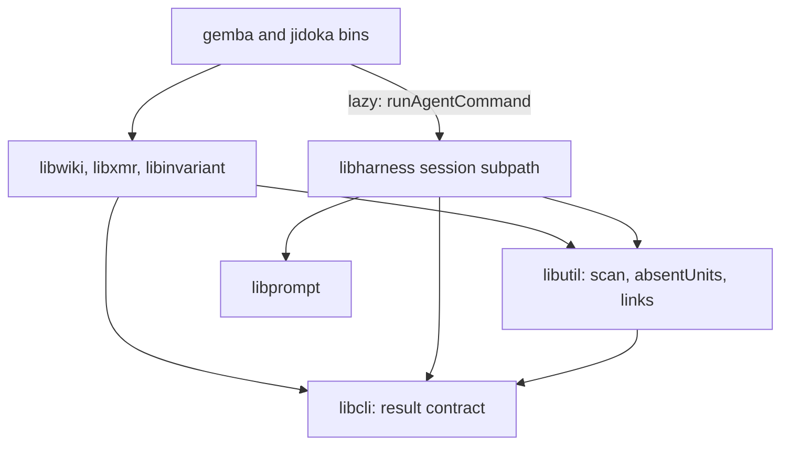
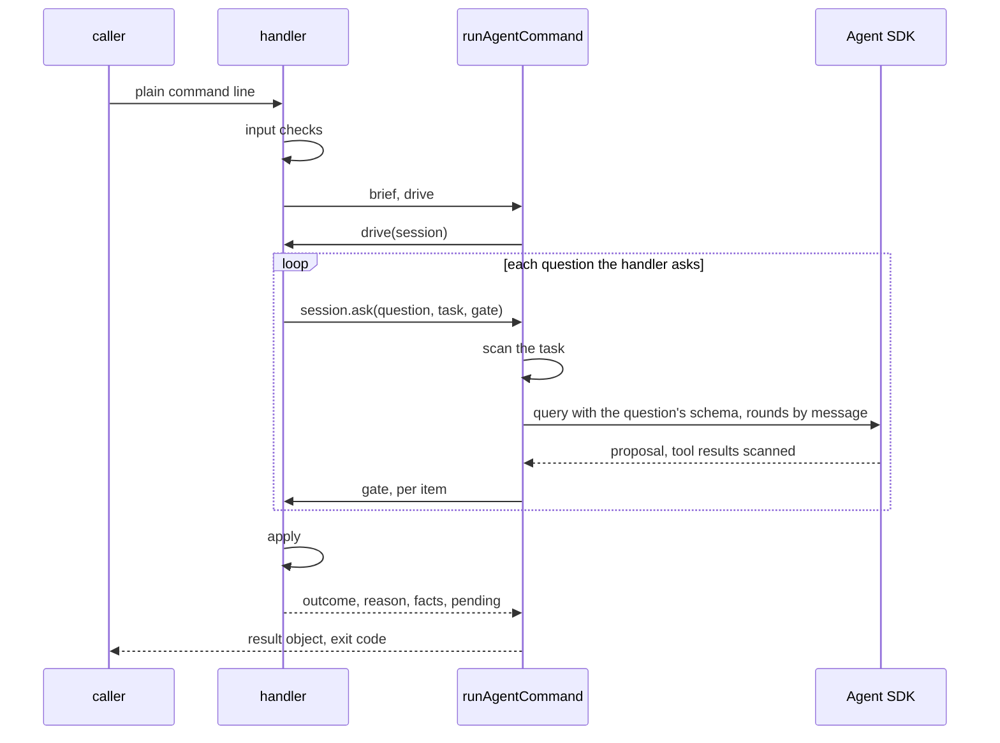

# Design 2410-a: one command session in the runtime, one result contract in the CLI layer, and the judgment as data in each domain library

Spec 2410 turns nine commands into agent-backed commands with one path, gates
that decide, and one result contract. This design fixes the components, the
dependency direction, the session and gate interfaces, the publish flow, the
outcome table, and the removals. It lands after spec 2370's open parts, 2390,
and 2400, and rebases onto them.

## Components

| Component | Home | Role |
| --- | --- | --- |
| Result contract | `libcli` | The outcomes, exit codes, and `resolveOutcome` (the spec's precedence). The six-field result object, with `pending` items in `libutil`'s finding shape, and its renderer (`next` to stderr). The base reason table, which holds the ids several commands share (`written`, `answered`, `fixed`, `clean`, `findings-left`, `unresolved`, `gate-retries`, `no-wiki`). A removed-forms table that each CLI definition fills and the parser checks before dispatch. Option objects for `--verbose` and `--format` that a definition attaches by name. `finishAgentBacked(loader)`, the bin tail that imports the runner lazily, renders, and exits. |
| Command session | `libharness`, on its own subpath | `runAgentCommand(brief, drive)` opens a scope and calls `drive(session)`. The handler drives its own work and calls `session.ask(question, task, gate)` as often as it needs. Each `ask` is one SDK query with that question's schema, and its rounds go in through streaming input with `persistSession: false`. The session scans every text before the model sees it, enforces the limits, takes and restores the editor snapshot, writes the run trace, and maps SDK failures through its own reason table. `AgentRunner` and its callers stay as they are. |
| SDK options | The command session | `settingSources: []`, `skills: []`, `strictMcpConfig: true`, auto-memory off through the settings layer, the `tools` allowlist, and a PreToolUse hook that denies paths outside the write set and scans each file before a read. The reader's trace tools are the one MCP server, in-process. |
| Secret scan | `libutil` | `scanText` and `scanFiles` over gitleaks, beside the commit-range scan that moves from `libwiki`. A caller passes an allow rule. `libwiki`'s rule reads `FIT_WIKI_SECRET_OVERRIDE` and writes the `secret-overrides.log` record, which names the model provider, into the wiki write set. |
| Shared primitives | `libutil` | `absentUnits(before, after, split)` with `normLine`, which `libwiki`'s `findAbsent` and `normalizedKeySet` then call. The code-blanking link extractor from the repository invariant, which `libpack`, `libinvariant`, and the invariant import. |
| Briefs, handlers, gates, appliers | `libwiki`, `libxmr`, `libinvariant`, `libharness` (`ask`) | Each handler holds its input checks, its brief, its drive function, its gates, and its writers. A gate receives the proposal, the step's tool results, and for an editor the snapshot diff and the manifest. It returns a verdict per item. Each library ships its `.prompt.md` files, and the session loads them through `libprompt`. `libxmr` holds the metrics row writer and the metrics-reference reader. |
| Publish flow | `libwiki` | The lock, guards, replay, gates, ref update, and sync of § Publishing, behind one reason table. `completePendingSync()`, which the `gemba-wiki` bin calls before every command. `push --stop-hook`, the Stop-hook mode. |
| Trace tools | `libharness` | Read-only tools for overview, search, turn ranges, tool calls, errors, timeline, stats, cost, totals, and compare. Each kept trace-query method backs one. Lists are paged with a bound and a cursor, and thinking signatures are stripped. |
| Test doubles | `libmock` | A scripted session that answers each `ask` in turn, for the handler tests. `createMockAgentQuery` reads the streaming input per message and sends editor file effects through the hook, for the session tests. |
| Actions | `gemba-wiki`, `gemba-bootstrap`, `kata-agent`, `kata-interview` | The `gemba-wiki` action gains an `anthropic-api-key` input and a separate input for the free-text argument, which it passes quoted. Each action that carries the new binaries or the key releases under a new major. |

## Dependency direction

No domain library imports `libharness` or the Agent SDK. Briefs and verdicts
are plain objects. `libwiki` drops its `libharness` dependency, and its
existing edge to `libxmr` carries the row writer.

## Agent kinds

| Kind | Commands | Tools | Writes | Limit |
| --- | --- | --- | --- | --- |
| Proposer | `push`, `log`, `inbox`, `memo`, `claim`, `record` | None. The task carries the context. | None. The applier writes the accepted proposal. | 30 s per question, and `push` 60 s per call |
| Reader | `ask` | The trace tools only | None | 120 s per run |
| Editor | `jidoka fix`, `gemba-wiki fix` | Read, Glob, Edit, and Write | Only the write set | 180 s per run |

Each proposal item names the input id it answers, and the completeness gate
refuses an undecided id. For an editor, the session diffs the write set against
the snapshot it takes after any pre-pass. The manifest maps each edited file
to findings, findings that share a file form one group, and an edited file that
the manifest leaves out forms a refused group. Refused groups go back with
their reasons for up to three rounds. Each group still refused then returns its
files to the snapshot and deletes files it created, and the gates run once
more on the final tree until no kept group fails. A failed run restores the
whole write set. Kept and refused groups together end in `needs-human`.

## Data flow

The session scans what goes to the model, and the publish gate scans what
leaves for the wiki, the commit body included. Run traces go to a per-command
directory under the system temporary directory with mode 0600, and the session
deletes files there that are older than one day.

## Publishing

`push` asks two questions: the body and, on a conflict, the resolver. `claim`
and `release` ask none, and their row operation resolves the claims ledger in
the replay. A conflict elsewhere ends `claim` in `needs-human` and `release`
in its legacy exit 1.

1. A lock file records the holder's process and start time. A publish that
   finds a live holder ends in `failed` (`clone-busy`) at once. A holder whose
   process has gone, or one older than 300 s, is broken.
2. The guards run: a merge or rebase in progress, a detached head, and
   ancestry, which reaches the remote once. Every git network call has a
   20-second limit.
3. `push` commits the write-set under the fixed subject when one exists.
4. The body question runs. With nothing outgoing, it still runs, and the call
   ends in `noop` with no amend. Otherwise the session's commit takes the
   body, and the gates scan it.
5. The flow fetches, then replays each local commit not on the remote onto the
   fresh tip, in order, each with its own subject, in a temporary index. A
   file that one side changed takes that side. A file that both changed takes
   git's three-way merge under the wiki's attributes, so the union driver
   still merges the metrics CSVs. Each file that still conflicts goes to the
   resolver question. The claim check runs on every fetched tip.
6. The marker, secret, budget, conservation, and ancestry gates run on the
   replayed tree. The flow writes the pending-sync marker and moves the branch
   with a compare-and-swap ref update. A rejected push replays once more,
   with the resolver again for new conflicts. A second rejection ends in
   `failed`.
7. The sync brings the index and the working tree to the new commit. A path
   with uncommitted foreign work takes a three-way merge onto that work. A
   conflict there leaves the work as it was and ends in `needs-human`
   (`residue-conflict`), and the marker stays until every path is in line.

`pull` keeps its own rebase reconcile, out of scope.

## Outcomes

| Outcome | Exit | Reason ids, beside the base table's |
| --- | --- | --- |
| `done` | 0 | `landed` |
| `noop` | 0 | `nothing-to-push`, `claim-held`, `inbox-empty` |
| `failed` | 3 | `credentials`, `scanner-unavailable`, `sandbox-required`, `model-error`, `time-limit`, `schema-retries`, `turn-limit`, `network`, `rejected`, `clone-busy`, `marker-scan-failed` |
| `needs-human` | 4 | `both-sides-line`, `overlap-judged`, `residue-conflict`, `budget`, `mid-rebase`, `mid-merge`, `detached-head`, `would-publish-markers`, `conservation`, `row-conflict` |
| `blocked` | 5 | `secret-detected`, `unrelated-history`, `claim-taken` |

Each library exports one `REASONS` table, and a command's table can give its
own `next` for a base id. A repository invariant finds every `REASONS` export
and checks that ids are unique and that no `next` tells a caller to touch a
stash or declare a removal. The publish table replaces `refusalEnvelope`,
`PUSH_REASONS`, `WikiSyncRefusal`, `WikiPushFailure`, `AncestryRefusal`, and
`WikiSyncConflict`. The `release` handler maps it to its own legacy exits.

`gemba-wiki push --stop-hook` reads the hook input unless stdin is a terminal,
runs the push, and exits 2 on outcomes 4 and 5 unless `stop_hook_active` is
set, and 0 otherwise. `.claude/settings.json` and the `kata-setup` hooks
reference call it with a 120-second timeout.

## Key decisions

| Decision | Choice | Rejected | Why |
| --- | --- | --- | --- |
| Who writes | Proposers and the reader write nothing. Editors write their write set, gated by finding group. | Every agent edits files. All-or-nothing editor runs. | The writers already pass the audit. One finding the agent cannot fix must not void the rest. |
| Session shape | The handler drives a session scope and asks questions. | A fixed context, steps, then apply skeleton. | `push` does publish work between its two questions and may ask the resolver again. |
| Session class | A command session of its own over the SDK. | Extend `AgentRunner`. | `AgentRunner` serves five harness callers with `run` and `resume`. A second protocol in that class would serve neither well. |
| One query per question | Each question opens a query with its own schema. | One query for the call. | The SDK binds the output schema once per query. |
| Injection | The bins inject `runAgentCommand`. | Libraries import `libharness`. | An import puts the SDK under `libxmr` and the `jidoka` checks. |
| Contract home | `libcli` holds the result contract, the base reasons, the removed-forms table, and the option objects. Briefs and verdicts stay plain data. | All of it in the runtime. All of it in `libutil`. | Every CLI needs the contract. Agent terms stay out of the library every CLI loads. |
| Tool control | The `tools` allowlist, `strictMcpConfig`, and a PreToolUse hook. | A permission callback. | Bypass mode never calls the callback, and only `strictMcpConfig` keeps host servers out. |
| Merge seam | Replay in a temporary index, then sync with the marker. | Resolve in a stopped rebase. Keep the singleton loop. | A kill mid-rebase blocks every later push. A stale tree would make the next push revert the peers. |
| Lock | A lock file with the holder, and a busy clone fails at once. | Wait for the holder. A git ref lock. | A wait cannot fit the hook timeout. A file shows a dead holder. |
| Stop hook | A `push` mode that ships with `gemba-wiki`. | A justfile recipe. Shell in each settings file. | Every installation then runs one tested rule. |
| Secret scan | `libutil`, with two owners: the session for model input and the publish gate for what leaves. | `libsecret`. The `libharness` redactor. Whole read roots. | `libsecret` generates secrets. The redactor masks known literals. Old findings in sealed logs would block every run. |
| Prompt home | `.prompt.md` files loaded through `libprompt`. | JS modules. Agent profiles. | The repository already embeds prompt files this way. A Jidoka-only repository has no profiles. |
| Exit codes | 0, 0, 3, 4, 5. Exit 1 stays for an unexpected error. | 1 for `failed`. | A crash must not look like a retryable failure. |

## Removals

| Removed | Replaced by |
| --- | --- |
| `fix`'s private loop, round cap, task builders, profile prompt, its exits that skip the agent, and `libwiki`'s `libharness` dependency | The session and the `fix` brief |
| The flag parsers and options that spec § C lists, and the old exit codes | The free-text argument, the appliers, the removed-forms table, and the result contract |
| `product-mix`'s subprocess call, and `claim.js`'s `pushWiki`, `UNSAFE_STATE_REASONS`, and `NOT_PUBLISHED` | The `libxmr` row writer and the publish table |
| The nineteen query handlers, the query text renderer, and `--signatures` | `ask` and the trace tools |
| The six reason carriers, the rebase-and-autostash reconcile, `#reapplyLoop` with `maxReapply` and the singleton check, the `conflict`, `reapply-bound`, and `stranded-merge` reasons, and `exemptSummaryFiles` | The publish table, the replay, and the sync. The post-push tier-1 probe stays, and its detections go into `facts`. |
| `FIT_WIKI_SCANNER_ABSENT_OK`, the stale `-X ours` JSDoc, and `libwiki`'s private `scriptedQuery` | A scanner on every host, the replay, and the `libmock` doubles |
| Every removed form and old exit code in skills, profiles, actions, READMEs, tests, audit hints, help examples, pages, scripts, benchmarks, root documents, the justfile, and `package.json` | The new command lines |

## Contracts outside the components

| Contract | What it needs |
| --- | --- |
| Instruction budgets | The `gemba-wiki` skill sits at its line cap, and the `gemba-xmr` skill one word under its word cap. Both shrink, because their option tables go. `jidoka instructions` is the proof. |
| Specs 2370, 2380, 2390, 2400 | The 2370 release train lands first. The lock covers shared checkouts until 2380 lands. `--remove` stays a `push` input, and 2390's changelog takes two entries. `memo` reads 2400's roster, and its hooks reference calls `push --stop-hook`. |
| Release chain | The first merge publishes the libraries, `gemba`, `jidoka`, and a gear release, then the four actions under new majors and every repin. The second merge carries the instructions. |
| Follow-ups | Issues filed at plan time for the staff engineer: one moves the advisor and the judge onto the command session, and one moves `pull` onto the replay. |

## Risks

| Risk | Mitigation |
| --- | --- |
| A PreToolUse deny might not hold in bypass mode, or an empty `tools` list might drop the structured-output tool. | A live session test in the first plan part covers both. If either fails, the command session runs in `dontAsk` mode, which only it uses. |
| A root host refuses bypass mode unless it marks itself a sandbox. | The call ends in `failed` (`sandbox-required`) with a `next` that names the marker. The session never sets it. |
| Managed policy settings can carry hooks, and a credential kept only in Claude Code settings does not reach the agent. | Spec § A6 states both. The host exports the credential to the environment. |
| Editor runs may hit their 180-second limit. | `failed` restores the write set, and a retry starts fresh. |
| A model update changes the judgment. | The gates bound every write, and the scripted tests pin each outcome. |
