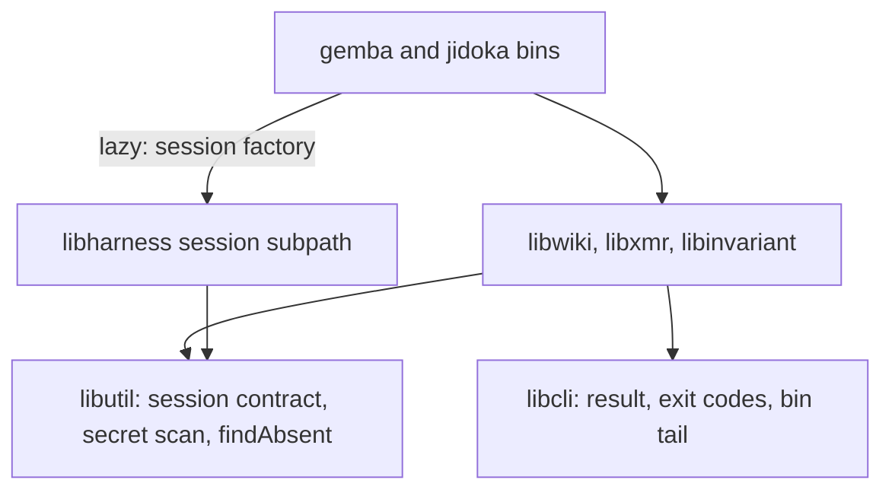
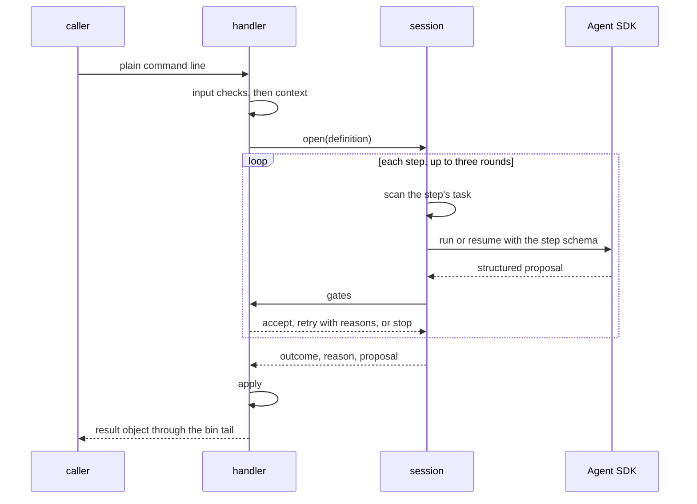

# Design 2410-a: one command-agent session in the runtime, one result contract in the CLI layer, and the judgment as data in each domain library

Spec 2410 turns nine commands into agent-backed commands with one path, gates
that decide, and one result contract. This design fixes the components, the
dependency direction, the session and gate interfaces, the push flow, the
outcome table, and the removals. It lands after specs 2370, 2390, and 2400
and rebases onto them.

## Components

| Component | Home | Role |
| --- | --- | --- |
| Session contract | `libutil` | Data shapes only: the definition (kind, prompt module, step schemas, read and write roots, step time limit), the gate verdict (`accept`, `retry` with reasons, `stop` with an outcome and a reason), and the reason table shape (reason, outcome, `next`). Every library imports it. |
| Command-agent session | `libharness`, exported on its own subpath | Opened per call from a definition. `step(task, schema, gates)` runs or resumes one SDK session for up to three rounds. It scans every text before the model sees it, enforces the step time limit, owns the editor snapshot and restore, writes the trace, keeps the SDK's session files in the run's temporary directory, and classifies SDK failures through its own reason table. |
| Agent runner | `libharness` | Gains the output schema, the SDK `tools` allowlist, and the `hooks` option. Command agents pass no setting sources, which is the runner's default. `authentication_failed` sets the `credentials` reason. The zero-usage check stays for a run that never starts. |
| Secret scan | `libutil` | `scanText` and `scanFiles` over gitleaks, beside the existing commit-range scan that moves with them from `libwiki`. Both honour `FIT_WIKI_SECRET_OVERRIDE` and write its audit line. |
| Result | `libcli` | The agent-backed outcome constants and exit codes, the six-field result object, its text renderer (`next` to stderr), one shared `--format` and `--verbose` option pair for `gemba-wiki`, and one bin tail that renders a result object, an `{ ok, code, error }` object, or a bare exit number. |
| Command definitions | `libwiki`, `libxmr`, `libinvariant`, `libharness` (`ask`) | Pure data per command. The handler takes the session factory from its deps. |
| Factory wiring | The `gemba` and `jidoka` bins | Each bin imports the session subpath lazily, only for an agent-backed command, and passes the factory into the handler deps. `jidoka fix` has its handler in the bin, beside the other `jidoka` handlers. |
| Context readers | The handler's library | The session diff, the inbox with the agent's summary, priorities, and claims, the current branch of the project checkout and its open pull request, the current weekly log, the roster and its descriptions, the declared metrics (the `Metric` and `Unit` columns of a skill's metrics reference), the route registry, and the findings. |
| Appliers | The handler's library | The log-block writers, the inbox actions, memo delivery, the claim writer, the publish flow, and a metrics row writer that `record` and `product-mix` share. Their flag parsers go. |
| Gates | The handler's library | The spec § B checks. Line survival and sentence conservation build on the `findAbsent` primitive in `libwiki`'s integrity module, which moves to `libutil`. |
| Publish flow | `libwiki` | The guards run before any mutation. A rebuild replaces the rebase-conflict abort for the session push. The re-apply operation can refuse, and a refusal drops the local commit. |
| Trace tools | `libharness` | Read-only in-process tools over the trace query and the multi-trace aggregates. Every list is paged with a bound and a cursor, and every result passes the scan. A query method that no tool uses goes. |
| Test doubles | `libmock` | `createMockAgentQuery` gains per-round structured output and editor file effects, for the session tests. A scripted session factory, for the handler tests. |
| Composite action | `gemba-wiki` action | An `anthropic-api-key` input, the name the kata actions use, passed to `push`. |

## Dependency direction

No domain library imports `libharness` or the Agent SDK. `libwiki` drops its
dependency on `libharness`. `libxmr` and `libinvariant` gain none.

## Three agent kinds

| Kind | Commands | Tools | Writes |
| --- | --- | --- | --- |
| Proposer | `push`, `log`, `inbox`, `memo`, `claim`, `record` | None. The task carries the context. | None. The applier writes the accepted proposal. |
| Reader | `ask` | The trace tools only | None |
| Editor | `jidoka fix`, `gemba-wiki fix` | Read, Glob, Edit, and Write | Inside the write roots only. A PreToolUse hook denies any path outside the roots, and it scans each file before a read. |

Schemas use enums for decisions and lists of records for items. Each item
names the input id it answers, and code maps the id to a location for
`pending`. The completeness gate refuses a proposal that leaves an input id
undecided. An editor's edits stay only when the gates accept all of them. Any
other end of an editor run restores every file under the write roots from the
snapshot that the session takes when it opens.

## Data flow

### The push flow

1. The existing guards run: rebase in progress, mid-merge, and ancestry.
2. The handler commits the write-set locally under the fixed subject.
3. Step one asks for the commit body, and the commit is amended with it.
4. The flow fetches and rebases. On a conflict it aborts, then rebuilds the
   session's change on the fresh tip, file by file. A file that one side
   changed takes that side. A file that both changed takes a three-way merge.
   Each file whose three-way merge conflicts goes to step two, the resolver,
   with its base, local, and remote text. The rebuilt commit replaces the
   local one.
5. The outgoing tree passes the marker, secret, budget, conservation, and
   ancestry gates, and the flow pushes. A rejected push rebuilds again,
   bounded by the existing re-apply limit, and step two runs again only for
   files that conflict again.

`claim` and `release` keep the singleton re-apply for their row and run no
push agent.

## Outcomes

| Outcome | Exit | Reasons |
| --- | --- | --- |
| `done` | 0 | `landed`, `reapplied`, and each command's success |
| `noop` | 0 | `nothing-to-push`, `already-satisfied`, `no-wiki`, a published claim the caller holds, and a clean inbox or fix run |
| `failed` | 3 | `credentials`, `model-error`, `time-limit`, `schema-retries`, `turn-limit`, `gate-retries`, `transport`, `rejected` after the bounded retry, `reapply-bound`, and an ancestry check that cannot reach the remote |
| `needs-human` | 4 | An `unresolved` item, a both-sides line, findings left by a fix, `residue-conflict`, `budget`, `precondition`, `mid-merge`, `stranded-merge`, `would-publish-markers`, `conservation` (its `next` asks a person to review the drop), and `scanner-unavailable` |
| `blocked` | 5 | `secret-detected`, `introduced-scan-failed`, unrelated or unborn history, another agent's claim, and a write outside the roots |

Each library keeps one reason table in the contract shape. The publish table in
`libwiki` replaces `refusalEnvelope` and the translations in the push and
claim handlers. `release` maps the same table to its own exit codes, as today.
The codes 3 to 5 belong to the agent-backed table only. `fit-landmark` keeps
its own codes.

This repository's Stop hook reads `stop_hook_active` from its input. It exits
2 on codes 4 and 5 unless that flag is set, and it exits 0 otherwise. Its
timeout is 120 seconds, above the push's worst case: two 30-second steps and
the network.

## Key decisions

| Decision | Choice | Rejected | Why |
| --- | --- | --- | --- |
| Who writes | Proposers and the reader write nothing. Editors write inside their roots, against a snapshot. | Every agent edits files. | The writers already pass the audit and keep the history rules. A proposal is small enough to gate before any write. |
| Dependency direction | Definitions are data, the contract sits in `libutil`, and the bin injects the session lazily. | Each library imports `libharness`. A static import in the bins. | An import would put the SDK under `libxmr` and the `jidoka` checks. The `libharness` index loads the SDK on import, so the bins import the session subpath only when an agent-backed command runs. |
| Gate verdict | `accept`, `retry`, or `stop`. | Accept or refuse. | A safety refusal must end the call at once. A retry invites the agent to reshape a proposal around the gate. |
| Tool control | The SDK `tools` allowlist and a PreToolUse path hook. Other runner callers keep `disallowedTools`. | A permission callback. A new permission mode. | The runner pins bypass mode, and the SDK never calls the callback there. A command agent's tool set is closed, so an allowlist states it. `allowedTools` only approves tools. |
| Merge seam | Abort, then rebuild on the tip file by file. | Resolve inside a stopped rebase. Reuse the singleton loop. | A hook timeout would leave a rebase in progress. The singleton loop takes one registered file and pushes past the gates. |
| Commit order | Guards, then commit, then the body. | Ask for the message first. | An outage then leaves a local commit that the next push carries. |
| Secret scan | The session scans each text before the model sees it. The publish gate keeps its own scan of what leaves. | One scan before the run. Scan the read roots. | Step two's task is built after the run starts. A whole-tree scan blocks on old findings in sealed logs that no command can edit. |
| Scan home | `libutil`. | `libsecret`. `libwiki`. | `libsecret` generates secrets and edits env files. Every command library depends on `libutil`. |
| Result home | `libcli`, with one bin tail for three shapes. | A branch in each bin. | `libcli` already owns help, usage, and exit codes, and every bin imports it. |
| JSON switch | One shared option pair on the six `gemba-wiki` commands. The existing globals elsewhere. | A global `--format` from `libcli`. | `gemba-xmr` and `gemba-trace` declare a global `--format`, and `libcli` refuses a duplicate. `gemba-wiki`'s other commands keep their values. |
| Exit codes | 0, 0, 3, 4, 5. Exit 1 stays for an unexpected error. | 1 for `failed`. Reuse 2. | A crash must not look like a retryable failure. `libcli` gives 2 to usage errors. |
| Structured output | The SDK output schema. | A conclude tool. Parse the text. | A conclude tool is optional to call. The judge keeps `Conclude` on purpose, because its sessions are multi-party. |
| Agent instructions | A prompt module per definition. | Agent profiles. Markdown assets. | A Jidoka-only repository has no profiles. A module ships inside the compiled binary. |
| Setting sources | None. | Load the project settings, as `fix` does today. | The project Stop hook runs `push`, and `push` starts an agent, so the run would recurse. |
| Model | The fast model constant. | A larger model for `ask`. | One constant to measure first. |
| Claim grammar | Four forms in `libwiki`, used by `claim` and `release`. | Free ids. An agent-backed `release`. | The agent's id must stay matchable by a deterministic `release`. |
| Run files | One temporary directory per run holds the trace and the SDK session files. The session deletes run directories older than one day. | Discard the trace. The user's Claude projects directory. | The trace is the evidence `gemba-trace` studies. The Stop hook runs every turn, so the files must age out. |

## Removals

| Removed | Replaced by |
| --- | --- |
| `fix`'s private loop, round cap, task builders, profile prompt, its three exits that skip the agent, and `libwiki`'s `libharness` dependency | The session and the `fix` definition. The rotation pre-pass stays before step one. |
| The flag parsers of `log`, `inbox`, `memo`, `claim`, and `record`, and the options spec § C lists | The free-text argument and the appliers |
| `product-mix`'s subprocess call to `gemba-xmr record` | The shared row writer |
| The nineteen query handlers, the text renderer of the queries, and the options no kept command uses | `ask` and the trace tools |
| `refusalEnvelope` and the push and claim translations | The publish reason table |
| `FIT_WIKI_SCANNER_ABSENT_OK` and its audit entry kind | A scanner on every host |
| The stale `-X ours` JSDoc in the publish flow | The merge seam |
| `libwiki`'s private `scriptedQuery` test helper | The `libmock` doubles |
| Every removed form in skills, profiles, references, actions, READMEs, audit hints, help examples, pages, scripts, the justfile, and `package.json` | The new command lines |

## Contracts outside the components

| Contract | What it needs |
| --- | --- |
| Instruction budgets | The `gemba-wiki` skill sits at its line cap, and the `gemba-xmr` skill sits one word under its word cap. Both shrink, because their option tables go. `jidoka instructions` is the proof. |
| Specs 2370, 2390, 2400 | `--event-type` and its rule stay. The declared-removal option stays a `push` input. `memo` and the roster rule read 2400's roster. |
| Release chain | One merge. `libutil`, `libcli`, `libharness`, `libwiki`, `libxmr`, `libinvariant`, and `libmock` publish, then `gemba` and `jidoka`, then a gear release. The `gemba-wiki` action ships its input and re-tags. `kata-agent`, `kata-interview`, `eval-guide.yml`, and `FIT_GEAR_RELEASE` repin. |
| Metrics references | The `Metric` and `Unit` columns of `references/metrics.md` become a machine contract for skill authors. |
| Other single-agent wrappers | The advisor and the judge keep their own time limits and failure mapping. A later change can move them onto the session. |

## Risks

| Risk | Mitigation |
| --- | --- |
| A PreToolUse deny might not hold in bypass mode, or an empty `tools` list might drop the structured-output tool. | A live runner test in the first plan part covers both. If either fails, command agents leave bypass mode before any of them ships. |
| Every turn end in an interactive session runs a push agent. | The fast model, a short step, and the limits in § Outcomes. |
| A model outage fails every push. | The local commit stays, and the next push carries it. On an ephemeral runner the memory is lost, as with a transport failure today. |
| A host without gitleaks can run none of the nine commands. | `needs-human` with an install `next`. `gemba-bootstrap` already installs it in CI. |
| A model update changes the judgment. | The gates bound every write, and the scripted tests pin each outcome. |
| `ask` exhausts its context on a long trace. | Every trace tool pages its results. |
