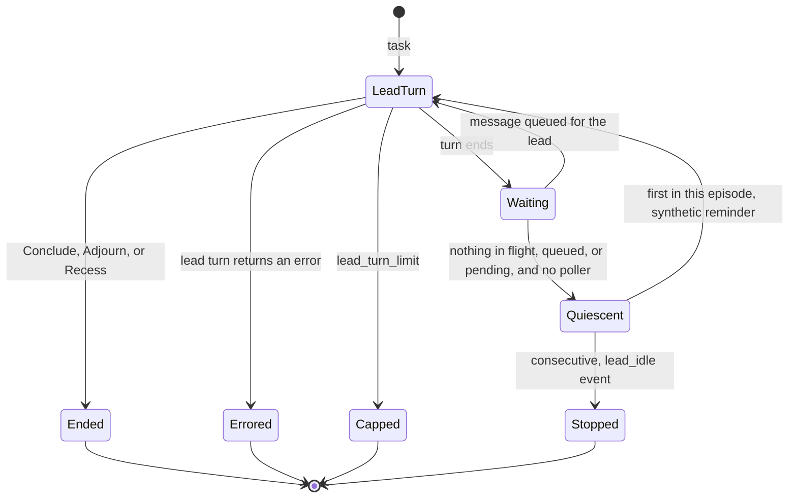
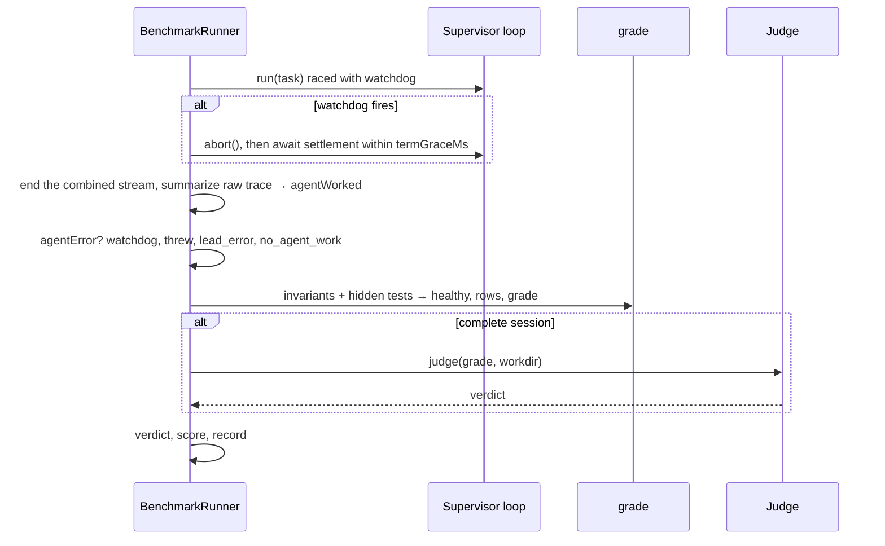

# Design 2420-a: The benchmark measures the agent-under-test

[Spec 2420](spec.md) asks for four things. A read-only role has no write path.
A quiescent session ends. A cell passes only when the agent did billed work. A
hook that emits nothing is a grader fault. This design puts each in one
component and removes the deny-lists it replaces.

## Components

| Component | Responsibility | Change |
| --------- | -------------- | ------ |
| `AgentRunner` | One SDK session with fixed options across run and resume. | Gains `tools`, the built-in tool allowlist the SDK loads. When `tools` is set the call omits `allowedTools`. Loses `disallowedTools`. `allowedTools` alone stays for participants. Exports `READ_ONLY_TOOLS` (Read, Glob, Grep) and `PROTOCOL_LEAD_TOOLS` (those plus Skill) beside its existing default list, and shares its token-sum helper. |
| Supervisor factory | Wires the supervisor and agent runners. | Lead runner gets `tools`. The input becomes `supervisorTools`, default `READ_ONLY_TOOLS`. The deny-list input and array go. |
| Facilitator and Discusser factories | Wire the lead and participant runners. | Lead runner gets `tools`. The facilitator input becomes `facilitatorTools`. Both default to `PROTOCOL_LEAD_TOOLS`. The deny-list input and arrays go. |
| Advisor | Read-only consult to a stronger model. | `tools: READ_ONLY_TOOLS` replaces its allow and deny pair. Its prompt trailer stays accurate. |
| Judge | Separate session that concludes a verdict. | `tools` input, default `JUDGE_TOOLS`, which is `READ_ONLY_TOOLS` plus Bash. Its prompt trailer stays accurate. |
| `gemba-harness supervise`, `kata-interview` action | Public callers of the supervisor's tool set. | The flag feeds `supervisorTools`. The action default drops Write and Edit. |
| `OrchestrationLoop` | One lead, N participants, one bus. | Counts turns in flight. Detects quiescence at every turn end. Reminds once per idle episode, then stops with `lead_idle`. Throws `LeadSessionError` when a lead turn returns an error. Exposes `abort()`. |
| `MessageBus` | Per-participant queues. | `hasPending()` with no participant answers for every queue. |
| `BenchmarkRunner` | Cell lifecycle. | Completeness gate before the judge. Watchdog calls `abort()` and awaits a bounded settlement. |
| `raw-summary` | Derives cost, turns, submission from the raw trace. | Also derives `agentWorked` from agent-lane assistant usage. |
| `grade`, `gemba-benchmark grade` | Check-row arithmetic and grader health. | A present invariants script with zero rows is unhealthy. The `grade` command shares the rule and the record field. |
| `result`, `gemba-benchmark report` | Record schema and the pass@k report. | `agentError.reason`, `invariants.error`. The report prints the reason before the message. |
| `index.js` | Public exports. | Exports the three tool constants beside `createJudge`. |

## Session termination

Quiescence is a predicate over loop state: no runner mid-turn, no queued
message, an empty ask ledger, no inbox poller, `ctx.concluded` false. A turn
in flight is any `run` or `resume` call, including the owed-ask reminder
resume. The loop marks a turn in flight synchronously when it drains the
queue, before the first await, so the microtask window between drain and SDK
call never reads as quiescent. The loop evaluates the predicate when any turn
ends, lead or participant, so a participant that is still working when the
lead's turn ends keeps the session alive until it finishes, and a participant
whose turn ends into silence triggers the same check. The lead wakes through
its two existing signals: the reminder is a queued synthetic message, and the
stop resolves the done promise. An inbox poller is a wake source the loop
cannot observe, so a discuss session that carries one never reaches
`Quiescent`.

The reminder is one synthetic line on the lead's queue: the turn ended with no
`Ask` pending and the session still open, so call `Ask` or your terminal tool.
The reminded flag resets when a lead turn issues an `Ask`, when a message is
delivered to the lead, or when the session ends. The `lead_idle` event carries
`agent` and `mode`, like `protocol_violation`. The trace collector drops both
from the text stream and keeps both in the NDJSON file, so the event is
visible in the trace artifact and not in the live log.

A lead `run` or `resume` that returns an error, which the runner sets for an
SDK throw or a session with no model work, makes the loop throw
`LeadSessionError` through its existing abort path. The commands see the
rejection they already see for a participant crash. A result with an error
subtype and no error object continues as today. A participant error keeps its
path: its owed ask is reminded, then cancelled with a synthetic null answer.

`abort()` is the existing private stop made public. It flips `stopped`,
resolves the done promise, and aborts every runner's current query, which
terminates the SDK subprocess. An ended session aborts participants mid-turn,
as today. The agent's billed work before that point is what the cell measures.

## Cell flow

After the watchdog fires the runner awaits the aborted session, bounded by
the per-task termination grace it already holds, before it ends the combined
stream. The loop's last lines then land in the file the summary reads. A
subprocess that survives its abort past the grace is left to the workdir
teardown's process-group kill, as today, and the record still lands.

The verdict rule is `pass` only when `agentError` is absent, the grade passes,
and the judge passes. `scoreValid` adds `agentError` absent to its existing
conjunction, so an incomplete scored cell records score zero. The record
keeps every field it has today. The loop's return value no longer feeds the
record: the lead's verdict is advisory, and the dead `result.concluded` read
goes with the "did not succeed" error. `costBreakdown.agent` still sums
terminal results and can read zero for an agent cut short by the lead's
conclusion. `agentWorked` is the completeness signal, not the cost.

## Interfaces

| Interface | Shape |
| --------- | ----- |
| `createAgentRunner({ tools })` | `tools?: string[]`. Passed to the SDK `tools` option on every call, and the call then omits `allowedTools`. Absent means the SDK default set with the runner's `allowedTools`, which is what participants get. |
| `READ_ONLY_TOOLS`, `PROTOCOL_LEAD_TOOLS`, `JUDGE_TOOLS` | `["Read", "Glob", "Grep"]`, that plus `"Skill"`, and the first plus `"Bash"`. The first two live in the agent runner module, the third in the judge module. All three are public exports. |
| `createSupervisor({ supervisorTools })`, `createFacilitator({ facilitatorTools })`, `createJudge({ tools })` | Each defaults to its constant. The supervise command maps `--supervisor-allowed-tools` to `supervisorTools`. |
| `OrchestrationLoop.abort()` | Public face of the private stop. |
| `LeadSessionError` | Thrown by `run()` when a lead turn returns an error. Carries the runner's error as `cause`. |
| `MessageBus.hasPending(participant?)` | True when the named queue, or any queue, holds a message. |
| `summarizeRawTrace()` | Adds `agentWorked: boolean`, true when the agent lane's assistant messages carry token usage above zero, through the runner's token-sum helper. |
| `runProducersAndGrade()` | `healthy` is false when the task has an invariants script and `details` is empty. The invariants result gains `error: "hook emitted no check rows"`. |
| Result record | `agentError` is `{reason, message, aborted}`. `reason` is one of `watchdog`, `threw`, `lead_error`, `no_agent_work`, in that precedence. `message` keeps the thrown or SDK error text. `aborted` is true on the watchdog path. `invariants.error` is optional, on the run record and the grade record alike. |

## Key decisions

| Decision | Rejected alternative | Why |
| -------- | -------------------- | --- |
| The lead's tool surface is an SDK `tools` allowlist. | Extend the deny-list with Bash, as 7f15d1a0d did for every lead, or a `canUseTool` callback. | A deny-list races a growing tool surface, and the stalled trace shows the lead routing around a refused `Write` through the Bash that #1536 restored. A callback leaves the tool in context. An allowlist cannot be routed around. |
| `Skill` only where a profile needs it. | Skill on every read-only role, or on none. | The coach and product-manager profiles declare skills and the prompt composer inlines none, so those leads reach their protocol only through `Skill`. A skill can run shell at load, so the supervisor, advisor, and judge do not carry it. |
| The lead constants live in the runner module and are exported. | One constant in the orchestration toolkit. | The runner owns the SDK tool options, and the advisor imports no orchestration module for one constant. A caller that widens `createJudge({ tools })` needs the base list. |
| A runner with `tools` omits `allowedTools`. | Mirror `tools` into `allowedTools`. | The pinned SDK deprecates `Skill` in `allowedTools`, and under bypass mode the permission list restricts nothing. Grep and Glob listed in `tools` suffice on native builds. |
| The agent-under-test keeps `allowedTools` semantics. | Move every role to `tools`. | Its effective surface is the full built-in set today. Removing `Skill` and the rest changes what the benchmark measures. |
| Quiescence is the terminal condition, evaluated on every turn end. | Check the ask ledger after the lead's turn only, or a shorter watchdog. | The lead-only check misses a participant that ends into silence, and the race is real in discuss mode. A timer measures nothing. |
| One reminder per idle episode, then stop. | Stop at first quiescence, or one reminder per session. | Symmetric with the per-ask `reminded` flag. A lead that recovers is not stopped on a later lapse without a reminder. |
| Completeness is billed agent work from assistant usage. | The agent lane holds a terminal result, or the cost path's result sum. | A lead may end the session between the agent's `Answer` and its `result`, which aborts the turn and drops both the result and its cost. Assistant usage is already in the lane. |
| A lead error throws a typed error. | Reuse the untyped abort path. | The runner catches one rejection for a participant crash and a lead error alike, and the record must name which. |
| An incomplete cell fails with `agentError`. The producers still run. The judge does not. | A third verdict, or always judge, or skip grading too. | A preflight failure already records a harness fault as `fail`. The producers are cheap and keep the record's shape. The judge costs about 0.5 USD per cell for a verdict the gate ignores. |
| Zero rows from a present hook is unhealthy. | An `$ASSERT` handle in the hook env. | Adds a contract to every family and still needs the health rule. The health rule alone makes a renamed CLI loud. |
| The watchdog calls `abort()` and awaits a bounded settlement. | Leave the dangling race loser, or await with no bound. | A dangling loop writes after the stream ends. An unbounded await turns a hung subprocess into a hung shard with no record. |
| `--supervisor-allowed-tools` keeps its name. The factory inputs become `*Tools`. | Rename the flag, or keep `*AllowedTools` inputs beside `allowedTools`. | The flag is public and its name already states the new meaning. Inside one factory signature, two inputs named "allowed" with different semantics mislead. |

## Removed

| Removed | Replaced by |
| ------- | ----------- |
| `defaultDisallowed` arrays in the supervisor, facilitator, and discusser factories | `tools` |
| `supervisorDisallowedTools` and `facilitatorDisallowedTools` inputs | Nothing. No production caller passes them. |
| `supervisorAllowedTools` and `facilitatorAllowedTools` inputs | `supervisorTools` and `facilitatorTools` |
| `ADVISOR_DISALLOWED_TOOLS` and `ADVISOR_ALLOWED_TOOLS` | `tools: READ_ONLY_TOOLS` |
| `DEFAULT_JUDGE_ALLOWED_TOOLS` and `createJudge({ allowedTools })` | `JUDGE_TOOLS` and `createJudge({ tools })` |
| `AgentRunner.disallowedTools` and its SDK pass-through | `tools` |
| The runner's `supervisor did not succeed` error and its dead `result.concluded` read | The four `agentError` reasons |
| Write and Edit in the `kata-interview` action's `supervisor-allowed-tools` default | The default without them |
| `fit-trace` in seven hooks and the `jidoka-skills` README | `gemba-trace` |

## Risks

| Risk | Mitigation |
| ---- | ---------- |
| A lead needs a tool outside its default set. | `supervisorTools` and `facilitatorTools` are the explicit widening. `Eval: Guide` passes no flag and needs none, since its lead verifies by reading a file. |
| Discovered skills still enter a lead's prompt through the SDK's default `skills` handling. | Intended for the facilitator and discuss lead, which carry `Skill`. Inert for the supervisor, advisor, and judge, which cannot invoke them. |
| The hooks depend on the runner's PATH. | `gemba-bootstrap` installs `gemba-trace` in its default tool set, and the failed run's log lists it. Part D makes a future rename loud. |
| Test fixtures and seams return empty row sets. | The libharness suite has invariants seams that return `details: []` and one fixture hook that writes no row. The plan updates them to emit a row or to declare no script. |

## Docs touched

- libharness README: a built-in tools column in the tool-surface table, and
  `lead_idle` in the trace-format event list.
- Run-eval guide: the supervisor's default is read-only. The flag widens it.
- Run-benchmark guide: a cell fails as incomplete, with the four reasons. A
  hook emits at least one row.
- Coordinate-team guide: the supervise lead no longer gets Bash by default.
  The deadlock section gains the quiescence reminder and `lead_idle`, visible
  in the trace file. The exit-code section gains the idle stop and the lead
  error.
- `gemba-harness`, `kata-agent`, and `kata-interview` action READMEs: the flag
  rows state the default, and the agent `allowed-tools` row states that it is
  a permission list. The `gemba-harness` help text states the default.
